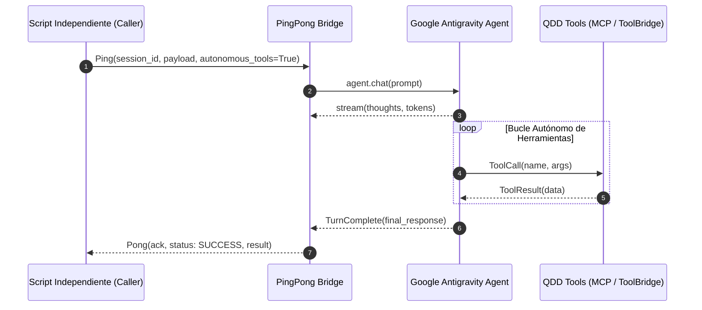

# QDD Antigravity Tools & Autonomous Ping-Pong Bridge ⚡📡🤖

Este skill proporciona la arquitectura completa, SDKs multilinguaje (Python, Node.js, Golang) y guías paso a paso para conectar cualquier script o pipeline automatizado con el ecosistema de agentes **Google Antigravity**, utilizando su SDK oficial (`google.antigravity`), CLI local (`agentapi`), integración MCP y el protocolo reactivo **Ping-Pong** con ejecución autónoma de herramientas.

---

## 🎯 CAPACIDADES PRINCIPALES

1. **Motor de Ejecución Híbrido Multicapa**:
   - **Capa 1: SDK Nativo (`google.antigravity`)** si `GEMINI_API_KEY` está configurada.
   - **Capa 2: CLI Local (`agentapi new-conversation`)** con detección automática del binario y streaming de `transcript.jsonl` / `verdict.json`.
   - **Capa 3: Bridge MCP JSON-RPC**.
   - **Capa 4: Deterministic Offline Stream Adapter** para pruebas unitarias ultra rápidas y CI air-gapped.
2. **Bucle Autónomo de Herramientas (Autonomous Tool Loop)**:
   - Capacidad del cliente para recibir llamadas a herramientas (`tool_calls`) del LLM, ejecutarlas inmediatamente contra el `ToolBridge`, alimentar los resultados al LLM y continuar de forma autónoma hasta obtener el `PONG` definitivo.
3. **Protocolo Ping-Pong (Zero-Polling Handshake)**:
   - Elimina los bucles de espera ciegos (`while True: sleep()`) mediante el modelo de eventos reactivos (**Reactive Wakeup**).
4. **Sanitización Robusta de Respuestas (`extract_json_block`)**:
   - Soporte nativo para bloques delimitados `[VERDICT_START]...[VERDICT_END]`, bloques markdown ````json```` y raw JSON.

---

## 🔄 CICLO DE VIDA PING-PONG Y BUCLE AUTÓNOMO



---

## 📁 GUÍAS Y REFERENCIAS TÉCNICAS

- 🚀 **[Guía de Activación y Paso a Paso: Ping-Pong](references/ACTIVATION_AND_PING_PONG_GUIDE.md)**: Tutorial completo de 5 pasos para dejarlo funcionando de inmediato.
- 🔄 **[Bucle Autónomo de Herramientas](references/AUTONOMOUS_TOOL_LOOP.md)**: Especificación técnica del ciclo autónomo multi-paso.
- 🛡️ **[Patrones de Integración y Testing (Tenderbot)](references/AGENTAPI_INTEGRATION_AND_TESTING_PATTERNS.md)**: Lecciones aprendidas en producción con `agentapi` y mock tests.
- 📡 **[Especificación del Protocolo Ping-Pong](references/PING_PONG_PROTOCOL.md)**: Detalle del handshake, tipos de mensajes y recuperación idempotente.
- 📜 **[Prompt Maestro Paso a Paso](references/PROMPT_STEP_BY_STEP.md)**: Prompt de sistema optimizado para orquestar agentes.

---

## 🚀 EJEMPLOS RÁPIDOS DE USO

### 1. Python (`examples/python_ping_pong_example.py`)
```python
import asyncio
from runtime.python.ping_pong_client import AntigravityPingPongClient
from runtime.python.tool_bridge import QDDToolBridge

async def main():
    bridge = QDDToolBridge()
    bridge.register_tool("audit_code", "Audita calidad", {}, lambda: {"score": 100})
    client = AntigravityPingPongClient(tool_bridge=bridge)
    
    async with client.session("sesion_01") as session:
        pong = await session.ping(
            prompt="Audita la arquitectura del proyecto.",
            on_token=lambda t: print(t, end="", flush=True),
            autonomous_tools=True
        )
        print(f"\n[PONG] Status: {pong.status} | Duración: {pong.duration_ms:.2f}ms")

asyncio.run(main())
```

### 2. Golang (`runtime/go/pingpong/`)
```go
tb := pingpong.NewToolBridge()
tb.RegisterTool("audit_code", "Audita código", nil, func(args map[string]interface{}) (interface{}, error) {
    return map[string]interface{}{"score": 100}, nil
})

client := pingpong.NewClient(pingpong.ClientConfig{ToolBridge: tb})
session := client.Session("sesion_go")
pong, err := session.Ping(ctx, "Ejecuta auditoría", pingpong.WithOnToken(func(t string) {
    fmt.Print(t)
}))
```

### 3. Node.js (`runtime/node/`)
```javascript
import { AntigravityPingPongBridge } from './runtime/node/ping_pong_bridge.mjs';

const bridge = new AntigravityPingPongBridge();
bridge.registerTool('audit_code', 'Audita código', {}, () => ({ score: 100 }));
bridge.on('token', (tok) => process.stdout.write(tok));
const pong = await bridge.ping('Ejecuta auditoría.');
```

---

## 🛡️ REGLAS INQUEBRANTABLES
1. **NUNCA USAR `else` ni `else if`** en el código de los clientes, bridges o scripts de integración.
2. **Salidas tempranas (`return`)** inmediatas ante cualquier fallo o error en el stream.
3. **Cero `sleep` de sondeo:** Usar siempre suscripción a eventos o promesas reactivas.
