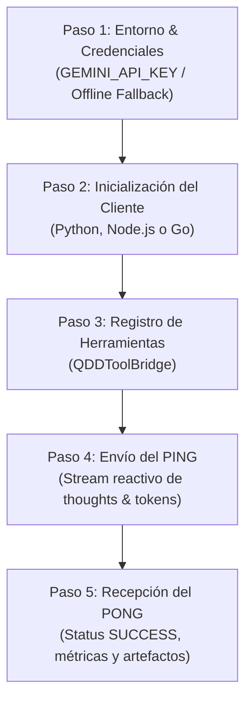

# Guía de Activación y Paso a Paso: Ping-Pong con Antigravity ⚡📡🤖

Esta guía detalla el procedimiento exacto para activar y dejar 100% operativo un script autónomo que utilice **Google Antigravity** como LLM/Agente de razonamiento, mediante el protocolo determinista **Ping-Pong** (sin bucles de polling).

---

## 📋 PASO A PASO: DE CERO A PING-PONG EXITOSO



---

### PASO 1: Configuración del Entorno y Credenciales

1. **Definir la clave de API (si se cuenta con acceso al SDK nativo):**
   ```bash
   export GEMINI_API_KEY="tu_api_key_aqui"
   ```
2. **Modo Offline / Determinista:**
   - Si `GEMINI_API_KEY` no está configurada, el cliente activa automáticamente el **Deterministic Stream Adapter**, permitiendo ejecutar pruebas unitarias y entornos de CI sin llamadas de red externas.

---

### PASO 2: Inicialización del Cliente Ping-Pong

#### En Python:
```python
from runtime.python.ping_pong_client import AntigravityPingPongClient

client = AntigravityPingPongClient(
    system_instructions="Eres un agente de arquitectura QDD gobernado por principios Clean Code."
)
```

#### En Node.js (ESM):
```javascript
import { AntigravityPingPongBridge } from './runtime/node/ping_pong_bridge.mjs';

const bridge = new AntigravityPingPongBridge({
  systemInstructions: 'Eres un agente de arquitectura QDD.'
});
```

#### En Golang:
```go
import "github.com/qdd-framework/qdd/plugins/qdd-antigravity-tools/runtime/go/pingpong"

client := pingpong.NewClient(pingpong.ClientConfig{
    SystemInstructions: "Eres un agente de arquitectura QDD.",
})
```

---

### PASO 3: Registro de Herramientas de Dominio (Tool Bridge)

Si el agente necesita interactuar con el entorno (ej. ejecutar tests, consultar bases de datos o leer archivos):

```python
from runtime.python.tool_bridge import QDDToolBridge

bridge = QDDToolBridge()

# Registrar una herramienta de consulta
bridge.register_tool(
    name="query_project_metrics",
    description="Obtiene el Quality Score actual del proyecto",
    parameters_schema={"type": "object", "properties": {}},
    handler=lambda: {"score": 100, "tendency": "Estable"}
)
```

---

### PASO 4: Envío del PING y Streaming Reactivo (Zero-Polling)

Se abre una sesión contextualizada y se envía el mensaje `PING`:

```python
import asyncio

async def ejecutar_ping_pong():
    async with client.session("mi_sesion_01") as session:
        print("[+] Enviando PING al agente Antigravity...")
        
        pong = await session.ping(
            prompt="Analiza la calidad del repositorio y resume los hallazgos.",
            on_thought=lambda th: print(f"🧠 [Pensamiento]: {th}"),
            on_token=lambda tok: print(tok, end="", flush=True),
            on_tool=lambda t: print(f"🔧 [Herramienta]: {t.get('name')}")
        )
        
        return pong

pong = asyncio.run(ejecutar_ping_pong())
```

---

### PASO 5: Recepción y Validación del PONG

El objeto `PongResponse` retornado garantiza la finalización del turno:

```python
# Validación del estado de la respuesta
if not pong.is_success():
    print(f"❌ [Error]: {pong.error}")
    exit(1)

print(f"\n✅ [PONG RECIBIDO]")
print(f" - Sesión:     {pong.session_id}")
print(f" - Turno:      {pong.turn_id}")
print(f" - Duración:   {pong.duration_ms:.2f}ms")
print(f" - Status:     {pong.status}")
print(f" - Contenido:  {pong.content}")
```

---

## 🔄 PASO 6: Conversación Multi-Turno Idempotente

Para continuar la interacción sin perder el historial:

```python
async with client.session("sesion_persistente") as session:
    # Turno 1
    pong1 = await session.ping(prompt="Paso 1: Genera el esquema de base de datos.")
    
    # Turno 2 (reutiliza el contexto del turno 1 automáticamente)
    pong2 = await session.ping(prompt="Paso 2: Ahora crea el script de migración SQL para ese esquema.")
```

---

## 🛡️ REGLAS DE CODIFICACIÓN EN CLIENTES Y SCRIPTS
1. **Zero-Else:** Nunca utilizar `else` para bifurcar estados de respuesta. Usar `if not pong.is_success(): return ...`
2. **Early Return:** Retornar inmediatamente al detectar un error en el canal de streaming.
3. **Cero `sleep` de espera:** No implementar bucles de sondeo. El método `.ping()` es una promesa asíncrona que se resuelve reactivamente.
