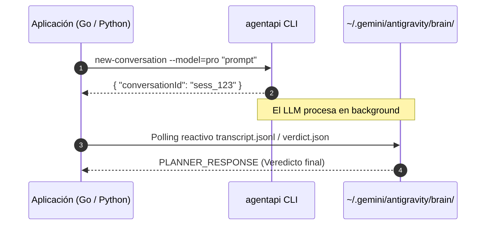

# Patrones de Integración y Testing de Antigravity (Caso de Estudio: Tenderbot-Agentes) 🤖🛡️

Este documento recopila las mejores prácticas, lecciones aprendidas y patrones de testing arquitectónico implementados en el proyecto de producción **`tenderbot-agentes`** para orquestar **Google Antigravity** mediante CLI local (`agentapi`), SDK y APIs externas.

---

## 🏗️ 1. PATRONES DE CONEXIÓN CON EL CLI LOCAL (`agentapi`)

### A. Detección Dinámica del Binario (Zero-Hardcoding)
Nunca se debe quemar la ruta absoluta a `agentapi`. Se debe utilizar `exec.LookPath` con fallback estructurado:

```go
func getAgentAPIPath() string {
    // 1. Intentar resolver desde el PATH del sistema
    path, err := exec.LookPath("agentapi")
    if err == nil {
        return path
    }

    // 2. Fallback al directorio estándar de Antigravity en el Home del usuario
    home, err := os.UserHomeDir()
    if err == nil {
        fallback := filepath.Join(home, ".gemini", "antigravity", "bin", "agentapi")
        if _, err := os.Stat(fallback); err == nil {
            return fallback
        }
    }

    return "agentapi"
}
```

### B. Inyección Dinámica del Modelo
El modelo no debe estar acoplado al código; se inyecta vía variables de entorno:

```go
model := os.Getenv("AGENT_MODEL")
if model == "" {
    model = "pro" // Fallback seguro para auditorías complejas
}
```

---

## ⚡ 2. SINCRONIZACIÓN ASÍNCRONA (BUG-006 & RESOLUCIÓN)

### El Problema
`agentapi new-conversation` retorna de inmediato un JSON con el `conversationId`, pero la generación del LLM ocurre en segundo plano de forma asíncrona.

### La Solución Arquitectónica
1. Extraer el `conversationId` del stdout inicial.
2. Localizar el transcript en:
   `~/.gemini/antigravity/brain/<id>/.system_generated/logs/transcript.jsonl`
3. Buscar la entrada con:
   - `source == "MODEL"`
   - `type == "PLANNER_RESPONSE"`
4. Verificar si existe un artefacto estructurado `verdict.json` generado por el agente.



---

## 🧪 3. PATRONES DE TESTING RIGUROSO (CERO FLAKINESS)

### A. Inyección de Dependencias para `runCommand` (Mocking Seguro)
Para evitar invocar el binario real o consumir tokens durante las pruebas unitarias en CI:

```go
type QAAgent struct {
    runCommand func(name string, arg ...string) ([]byte, error)
}

func NewQAAgent() *QAAgent {
    return &QAAgent{
        runCommand: func(name string, arg ...string) ([]byte, error) {
            cmd := exec.Command(name, arg...)
            return cmd.Output()
        },
    }
}
```

En el test unitario:
```go
func TestQAAgent_HallucinationDetection(t *testing.T) {
    agent := NewQAAgent()
    
    // Inyección de mock directo
    agent.runCommand = func(name string, arg ...string) ([]byte, error) {
        mockJSON := `{"hallucination": true, "reason": "Alucinación detectada en el anexo 2"}`
        return []byte(mockJSON), nil
    }

    res, err := agent.RunAudit()
    if err != nil {
        t.Fatalf("Error inesperado: %v", err)
    }
    if !res.Hallucination {
        t.Errorf("Se esperaba que la alucinación fuera detectada")
    }
}
```

### B. Delimitación Estricta de Respuestas (`[VERDICT_START]` / `[VERDICT_END]`)
Para evitar que explicaciones conversacionales rompan el parseo de JSON:

```text
Format the response between [VERDICT_START] and [VERDICT_END] tags:
[VERDICT_START]
{
  "valid": true,
  "reason": "Explicación técnica"
}
[VERDICT_END]
```

### C. Sanitizador de Bloques Markdown (`extractJSONBlock`)
```go
func extractJSONBlock(raw string) string {
    if strings.Contains(raw, "[VERDICT_START]") && strings.Contains(raw, "[VERDICT_END]") {
        start := strings.Index(raw, "[VERDICT_START]") + len("[VERDICT_START]")
        end := strings.Index(raw, "[VERDICT_END]")
        return strings.TrimSpace(raw[start:end])
    }
    
    clean := strings.TrimSpace(raw)
    clean = strings.TrimPrefix(clean, "```json")
    clean = strings.TrimSuffix(clean, "```")
    return strings.TrimSpace(clean)
}
```

### D. Bypass Condicional para Tests de Integración (`TESTING=true`)
```go
if os.Getenv("TB_TESTING") == "true" {
    return true, "Validación omitida en modo testing", uuid, tenderID
}
```

---

## 🛡️ 4. REGLAS INQUEBRANTABLES DE CODIFICACIÓN EN TESTS
1. **Zero-Else:** Todos los tests y funciones auxiliares deben usar cláusulas de guarda (`if err != nil { t.Fatalf(...); return }`).
2. **Early Return:** Cada aserción debe interrumpir inmediatamente la prueba si se detecta un fallo estructural (`t.Fatalf`).
3. **Limpieza de Recursos:** Usar `defer os.Remove(...)` y `defer server.Close()` para mantener el entorno de pruebas 100% aislado.
