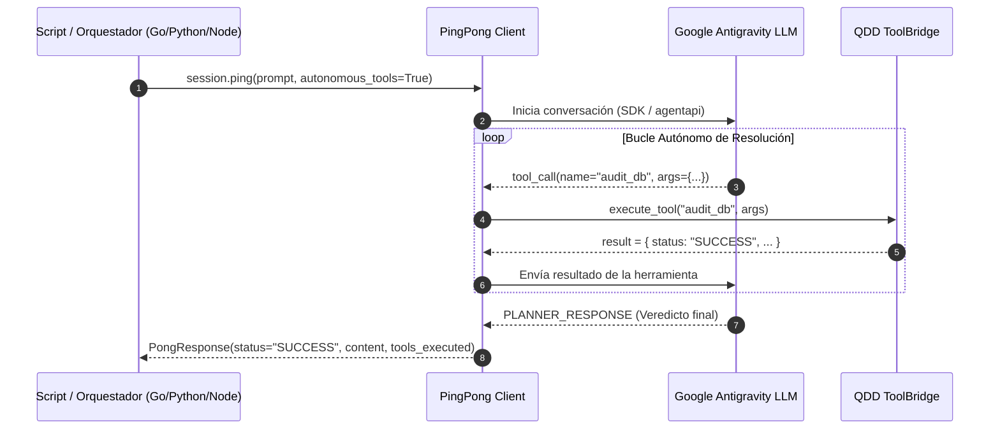

# Bucle Autónomo de Herramientas (Autonomous Tool Loop) 🤖🔄⚡

El **Autonomous Tool Loop** de QDD Antigravity Tools permite que un script o agente externo ejecute flujos de razonamiento y acción multi-paso de forma 100% autónoma y determinista, resolviendo invocaciones a herramientas en tiempo real sin requerir intervención manual ni bucles de sondeo ciego (Zero-Polling).

---

## 🎯 ¿CÓMO FUNCIONA?

---

## 🛡️ GARANTÍAS DE CALIDAD Y ROBUSTEZ
1. **Límite de Iteraciones (Safeguard):**
   - Máximo de 15 turnos de herramientas para prevenir bucles infinitos en caso de errores en cascada.
2. **Aislamiento de Excepciones:**
   - Si una herramienta falla, el error se captura y se entrega como payload estructurado `{"status": "ERROR", "error": "..."}` permitiendo que el LLM corrija su estrategia de forma autónoma.
3. **Audit Trail Inmutable:**
   - Cada herramienta ejecutada se registra en el array `PongResponse.tools_executed` para auditoría y certificación posterior.
4. **Cero Sentencias `else`:**
   - Todos los despachadores y manejadores implementan salidas tempranas y cláusulas de guarda.
