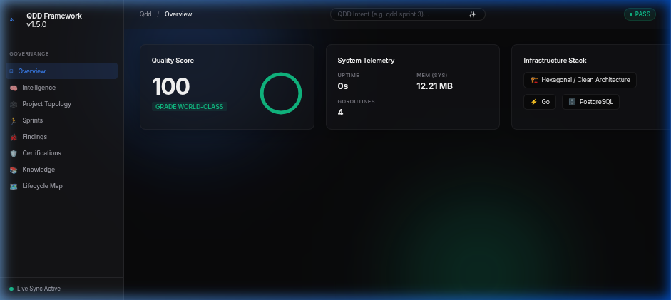
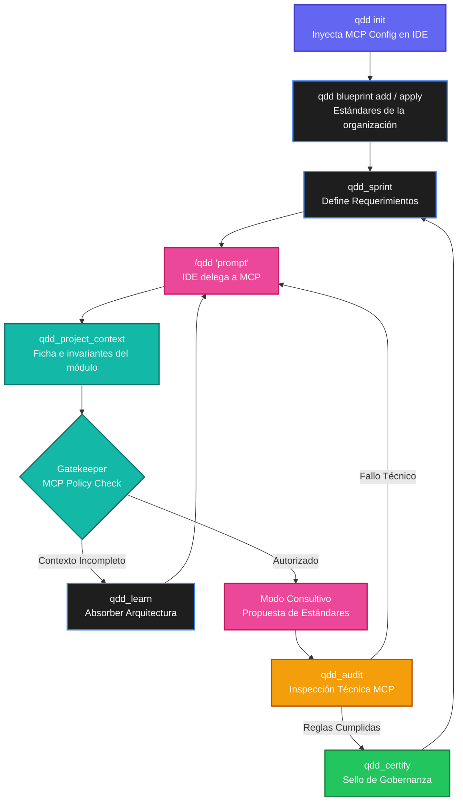

# QDD Framework — Quality-Driven Development

[](https://goreportcard.com/report/github.com/trdago/qdd-framework)
[](https://opensource.org/licenses/MIT)
[](https://github.com/trdago/qdd-framework/releases)
[](https://github.com/trdago/qdd-framework/actions/workflows/quality.yml)
[](#)

<p align="center">
  
</p>

> QDD no es un generador de código.  
> QDD no es un asistente de programación.  
> QDD no es un agente conversacional.  

**QDD es una Plataforma de Ingeniería de Software basada en Mejora Continua**, cuyo propósito es ayudar a construir y evolucionar productos de software preparados para producción siguiendo estándares de clase mundial.

La Inteligencia Artificial es solamente uno de sus motores. El verdadero propósito de QDD es preservar, incrementar y gobernar el conocimiento del proyecto durante todo su ciclo de vida.

---

## 🎯 Problema que buscamos resolver

Actualmente las herramientas de IA generan código, sin embargo:
- No preservan el conocimiento del sistema.
- Generan prototipos y maquetas desechables sin estándares de producción.
- No convierten los bugs en conocimiento permanente.
- No mantienen una certificación viva del software.
- Sacrifican la calidad y mantenibilidad a largo plazo por velocidad inmediata.

QDD resuelve este problema operando bajo el **Manifiesto QDD** y el principio fundamental de **Production-First Engineering**.

---

## 🧠 Filosofía y Principios Fundamentales

- **"Lo que no se mide no se mejora":** QDD rechaza las mejoras subjetivas. Todo avance debe ser medible, comparable y demostrable mediante métricas matemáticas (Score de Calidad 0-100, reducción de deuda técnica, horas ahorradas, cobertura de pruebas y certificaciones formales).
- **Production-First:** QDD no genera ejemplos desechables. Toda solución se diseña pensando en su operación a largo plazo y debe poder desplegarse en producción con calidad profesional.
- **El conocimiento es el activo principal:** El código no es la fuente de verdad, la fuente de verdad es el conocimiento acumulado (Certificaciones, ADRs, Findings).
- **Modo Consultivo y Certificación:** QDD actúa como un Arquitecto Principal. Nunca escribirá código deficiente ciegamente. Si detecta la oportunidad de implementar un estándar (ej. OpenAPI, OWASP, Clean Architecture), detendrá la ejecución, entrará en Modo Consultivo, explicará los beneficios y pedirá autorización.
- **Findings Become Knowledge:** Cada bug descubierto se transforma automáticamente en conocimiento permanente, generando nuevas pruebas, certificaciones y evidencias.
- **Backward Compatibility First:** Nunca se rompen contratos automáticamente. Si hay que modificar APIs o contratos públicos, el framework solicita autorización explícita.

---

## 🚀 Getting Started: Ciclo Completo de Desarrollo Gobernado

El siguiente ejemplo demuestra cómo se utiliza QDD para desarrollar de forma iterativa y segura.

### 1. Inicialización e Inyección de MCP
Prepara el entorno y haz que tu IDE (Claude Code, Cursor, Antigravity, OpenCode) absorba el contexto arquitectónico de tu proyecto automáticamente vía MCP:
```bash
qdd init
```

### 2. Identificación de Brechas (Auditoría Segura)
Corre las pruebas del proyecto y las reglas de QDD, y visualiza tu deuda técnica en el panel de control interactivo.
```bash
qdd audit       # Lo que bloquea vs. lo que es recomendación
qdd dashboard   # Visualiza el Centro de Comando (ver captura de arriba)
```

### 3. Estándares de tu Organización y Fichas de Módulo
Importa los blueprints de tu organización (usuarios y roles, notificaciones, auditoría…) y genera la ficha de cada módulo: su objetivo, sus invariantes y cómo se prueba.
```bash
qdd blueprint add git@github.com:org/qdd-blueprints.git --ref v1.0.0 notificaciones
qdd blueprint apply notificaciones --ruta internal/notificaciones
qdd modules approve notificaciones
```

### 4. Aplicación de Soluciones (Cognitive Path)
Delega la solución de problemas desde tu IDE. Antes de tocar código, la IA pide `qdd_project_context` y recibe la ficha del módulo; las herramientas MCP de QDD (`qdd_audit`, `qdd_learn`, `qdd_certify`) la gobiernan para que aplique estándares de producción.
```bash
/qdd "resuelve los bugs críticos identificados en el validador"
```

### 5. Certificación y Entrega Automática
Tu asistente verificará que el nuevo código pase `qdd_audit` (pruebas + reglas QDD) antes de sugerir el commit o el despliegue.

---

## 🔄 Ciclo de Vida (Arquitectura MCP)



---

## Instalación

### Opción 1: NPM (recomendada)
```bash
npm install -g qdd-framework
```

### Opción 2: Binario (sin Node)
Descarga el de tu sistema desde [Releases](https://github.com/trdago/qdd-framework/releases/latest) (Linux, macOS y Windows; amd64 y arm64), descomprímelo y deja `qdd` en tu `PATH`:
```bash
curl -fsSL https://github.com/trdago/qdd-framework/releases/latest/download/qdd_linux_amd64.tar.gz | tar -xz
sudo mv qdd /usr/local/bin/
```

### Opción 3: Desde el código (Go 1.24+ y Node para el dashboard)
```bash
git clone https://github.com/trdago/qdd-framework && cd qdd-framework
make install
```

### Primeros pasos
```bash
cd mi-proyecto
qdd init      # detecta el stack (también monorepos) y conecta tu IA
qdd audit     # revisa el proyecto; funciona desde cualquier subcarpeta
```
Lo temporal (scripts de un solo uso, pruebas manuales, logs, salidas) va en `./tmp`: `qdd init` la crea y git la ignora. Las IA conectadas a QDD también la usan.
En un proyecto nuevo, QDD parte en **adopción gradual**: las prácticas de madurez (E2E, ADR, Conventional Commits) aparecen como recomendaciones y no bloquean; las pruebas que fallan, OWASP o desplegar sin pruebas sí bloquean. Para exigirlo todo desde el día uno: `adopcion: estricta` en `.qdd/policies.yaml`.

---

## 🏗️ Arquitectura General

QDD está compuesto por:
- **Wisdom Registry:** La mente y constitución del proyecto (`.qdd/core/wisdom/`).
- **Fichas de módulo:** El objetivo operativo, el objetivo tecnológico y las invariantes de cada módulo (`.qdd/project/modules/`).
- **Blueprints:** Los estándares de módulo de tu organización, importados desde su propio repositorio a la carpeta central de QDD; el proyecto solo versiona `.qdd/blueprints.lock.yaml`.
- **Specification:** Definiciones independientes del modelo de IA.
- **Runtime MCP (Model Context Protocol):** El motor principal que expone las herramientas a tu IDE (`qdd_project_context`, `qdd_audit`, `qdd_certify`, etc.).
- **Dashboard:** Centro de Comando Web que despliega el *Intelligence Report*.
- **AI Adapters:** Integraciones Zero-Config para Claude Code, Cursor, Antigravity y OpenCode (`AGENTS.md`).

Detalle en [Architecture](docs/framework-architecture.md).

---

## 🌟 Capacidades Avanzadas

El framework soporta y obliga comportamientos avanzados tanto para humanos como para la IA:

1. **Intelligent Certification Tags:** Los certificados (`CERT-*.yaml`) ahora declaran `tags`. QDD asocia certificados automáticamente según los tags inferidos del código (ej. `.vue` hereda certificados con tags de `frontend`).
2. **Layered Certifications (Certificaciones Anidadas):** El motor exige que toda funcionalidad pase un nivel mínimo global (`core`) **Y** obligatoriamente al menos un certificado de negocio del proyecto (`isCore: false`). Si no existen certificados de negocio, la funcionalidad falla con la alerta `MISSING-PROJECT-CERT`.
3. **Zero-Else Enforcement Nativo:** El framework predica con el ejemplo; no utiliza la cláusula `else` ni `v-else` internamente, apoyándose 100% en *Guard Clauses* y retornos tempranos para bajar la complejidad cognitiva.
4. **Command Pipelining (`qdd run`):** QDD soporta encadenamiento secuencial nativo de comandos. Puedes ejecutar múltiples fases interdependientes como una tubería, aislando estado:
   ```bash
   qdd run audit certify
   ```
5. **Supervisión Resiliente y Auto-Reparación (`qdd run --keep-alive`):** QDD puede mantener vivo un proceso externo (un servicio, un binario), reiniciándolo en cada salida limpia. Ante un error real, registra un Finding + evidencia y delega el diagnóstico y la reparación a un agente de IA local disponible (Claude, Antigravity o Cursor), de forma desatendida, reintentando hasta 3 veces antes de detenerse para revisión humana:
   ```bash
   qdd run --keep-alive ./mi-servicio --puerto 8080
   ```
6. **Equipo Resolutor Multi-Agente (`/qdd resolve`):** Orquesta un equipo FAANG de 5 agentes especializados (Orquestador, Analista Integral, Implementador Senior, QA Zero-Mock y DevOps/SRE) con emisión de certificado de resolución firmado.
7. **Gobernanza y Certificaciones de Inteligencia Artificial:** Cumplimiento auditable de **ISO/IEC 42001 (AIMS)**, **ISO/IEC 29119-11 (AI Testing)**, **AICPA SOC 2 (Processing Integrity & Anti-Hallucination)** e **ISO/IEC 23894:2023 (AI Risk Management)** con Golden Sets deterministas.
8. **Sistema Unificado de Reportes (`qdd report`):** Genera reportes ejecutivos consolidados multi-formato (`text`, `md`, `json`) integrables en terminal y pipelines de CI/CD.
9. **Detección de Motores Locales & Ejecución en Dashboard:** Detección automática de **Antigravity** (Google AI), **Ollama**, **LM Studio**, **LocalAI/vLLM** y **Claude Code** para ejecutar intenciones y prompts en tiempo real directamente desde el Centro de Comando Web con streaming SSE.
10. **Gate Veraz:** `qdd audit` corre las pruebas reales del proyecto y bloquea si fallan, si no compilan o si no hay pruebas (`QA-00`, `QA-01`). También revisa los pipelines de GitHub Actions, Azure, GitLab y Bitbucket, y marca todo despliegue que no dependa de las pruebas o que despliegue aunque fallen (`CI-01`, `CI-02`).
11. **Fichas de Módulo (`qdd modules`):** Cada módulo tiene una ficha con su objetivo operativo, su objetivo tecnológico, sus invariantes y cómo se prueba. La IA la recibe con `qdd_project_context` antes de tocar el código, propone fichas nuevas con `qdd_module_save` (siempre en borrador) y un humano las aprueba con `qdd modules approve`. El gate avisa cuando el código se aleja de su ficha (`HEART-*`).
12. **Blueprints (`qdd blueprint`):** Los estándares de módulo de tu organización (vocabulario, preguntas de diseño, decisiones, invariantes y escenarios de conformidad) viven en su propio repositorio, privado si quiere, y se importan con un comando. Al aplicarlos, QDD pregunta las decisiones de diseño, genera la ficha del módulo y el gate vigila que no se altere ni quede atrás de su fuente (`BP-01` a `BP-06`). Los cambios al estándar van por PR (`contribute` → `propose` → `release`). La IA los usa sola: si pides *"agrega el blueprint de auditoría"*, lo importa, y te hace a ti sus preguntas. Ver [Blueprints](docs/blueprints.md).
13. **Estado por frente y consola de Claude Code (`qdd estado`, `qdd consola`):** Una tabla de frentes de trabajo por etapas (✅ con evidencia, ⏳ qué espera y de quién, ❌ la falla) que la IA actualiza antes de reportar y lee al retomar una sesión. `qdd consola activar` la muestra en un panel a la derecha de Claude Code, con botones para aprobar fichas y auditar, y «▶ Para ti»: los comandos que la IA no puede o no debe ejecutar (como publicar un tag) te quedan ahí para ejecutarlos con un clic y una confirmación. Ver [Command Reference](docs/command-reference.md#-estado-por-frente-y-consola-de-claude-code-rfc-0006).
14. **Adopción Gradual y Puntaje Único:** En un proyecto nuevo, E2E, ADR y Conventional Commits son recomendaciones que no bloquean; las pruebas, OWASP y los despliegues sin pruebas sí. Audit, certify, evolution, report, MCP y el dashboard usan el mismo puntaje.

---

## 📚 Documentación

| Documento | Para qué |
|---|---|
| [Getting Started](docs/getting-started.md) | De la instalación a tu primer módulo construido con IA. |
| [Command Reference](docs/command-reference.md) | Todos los comandos de la CLI, las tools MCP y las reglas del gate. |
| [Blueprints](docs/blueprints.md) | Crear el repositorio de estándares de tu organización y usarlo en cada proyecto. |
| [Architecture](docs/framework-architecture.md) | Cómo se arma QDD: Wisdom Registry, fichas, blueprints, motor y MCP. |
| [RFCs](rfcs/) | Diseño de cada capacidad (RFC 0003: Blueprints). |
| [CHANGELOG](CHANGELOG.md) | Qué trae cada versión. |

---

## 🤝 Contribuyendo y RFCs

QDD es un estándar abierto enfocado en gobernar el desarrollo de software seguro y auditable. Lee `CONTRIBUTING.md` para más información.

