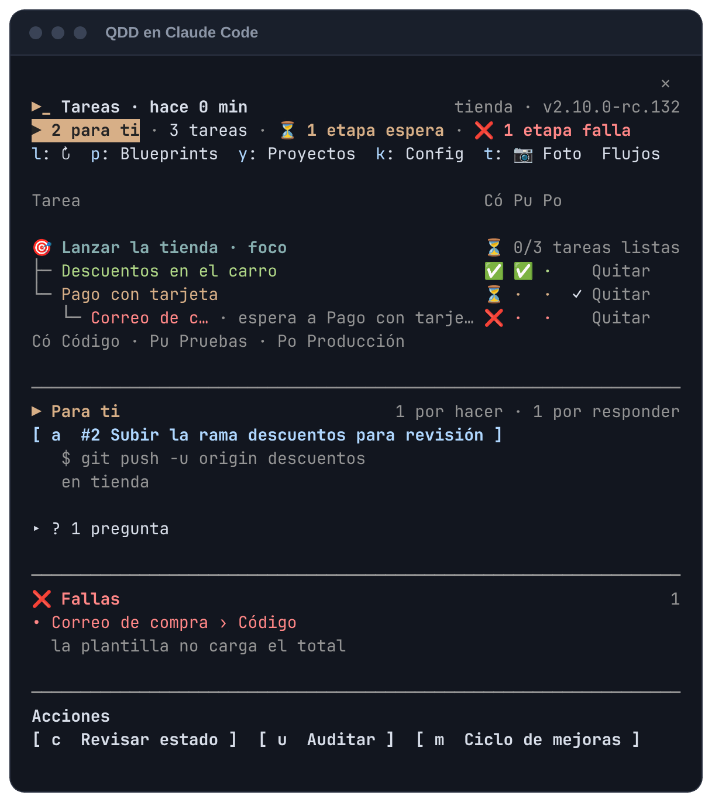
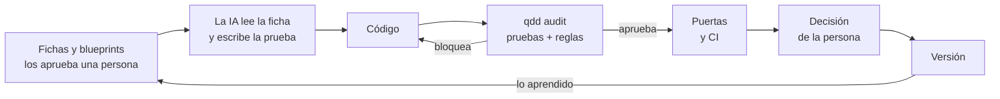
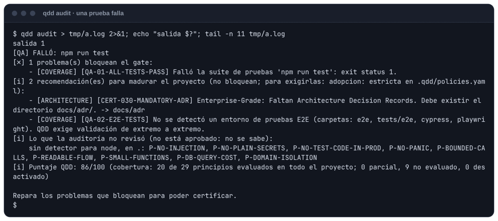

# QDD — Quality-Driven Development

[](https://www.npmjs.com/package/qdd-framework)
[](https://www.npmjs.com/package/qdd-framework?activeTab=versions)
[](https://github.com/trdago/qdd-framework/actions/workflows/quality.yml)
[](LICENSE)

**QDD hace que una IA que programa en tu proyecto trabaje con tu método, y te deja ver y decidir lo que importa.**

Es un CLI en Go, un servidor MCP y un panel. No genera código ni reemplaza a tu IA: le da el contexto de cada módulo antes
de que lo toque, revisa lo que hace con un gate determinista y te pasa a ti las decisiones que son tuyas. Funciona con
Claude Code, Cursor, Antigravity y OpenCode; [cuánto cubre en cada uno](#qué-cubre-en-cada-ia) está más abajo.



*El panel real, con un proyecto de ejemplo: el tablero, lo que espera tu «Sí» y lo que falla.*

## Qué problema resuelve

Las IA escriben código rápido, pero olvidan entre sesiones por qué las cosas son como son, se saltan pasos y dan por listo
lo que nadie comprobó. QDD lo ataca con cuatro ideas:

- **El conocimiento queda en el repositorio.** Cada módulo tiene una ficha con su objetivo, sus decisiones y lo que ningún
  cambio puede romper. Cada bug queda como un finding con la prueba que lo cubre.
- **Las reglas se comprueban, no se piden por favor.** `qdd audit` corre las pruebas y las reglas; las puertas frenan un
  commit sin auditar. Son deterministas: no llaman a un modelo ni gastan tokens.
- **Las decisiones son de la persona.** Publicar, aprobar una ficha o responder una pregunta de diseño espera tu «Sí», en
  el panel o en el teléfono.
- **Lo que no se midió se dice.** El gate informa qué no pudo revisar en vez de darlo por aprobado.

## Cómo funciona



Con una prueba en rojo, el gate termina con error y dice qué bloquea, qué recomienda y qué no pudo revisar:



## Instalar

```bash
npm install -g qdd-framework --allow-scripts=qdd-framework
```

npm 12 no corre los scripts de instalación sin esa bandera. Si instalas sin ella, qdd baja su binario desde el release de
GitHub la primera vez que lo usas.

| Otra forma | Cómo |
|---|---|
| **Canal preview** (las `-rc.N`, lo más nuevo) | `npm install -g qdd-framework@preview --allow-scripts=qdd-framework` |
| **Binario, sin Node** | [Releases](https://github.com/trdago/qdd-framework/releases): Linux y macOS (amd64 y arm64, `.tar.gz`) y Windows (amd64, `.zip`). Deja `qdd` en tu `PATH` |
| **Desde el código** | Go 1.25+ y Node 20.19+: `git clone https://github.com/trdago/qdd-framework && cd qdd-framework && make install` (deja `qdd` en `~/.local/bin`) |

Una versión con funciones nuevas sale primero en `preview` y pasa a `latest` después de horas de uso real medido
([RFC 0010](rfcs/0010-uso-medido-y-preview.md)). Esta página describe la 2.10.

## Empezar

```bash
cd mi-proyecto
git init           # si todavía no es un repositorio: las puertas se instalan como hooks de git
qdd init           # detecta el stack, escribe las reglas de tu IA y activa el gate
qdd audit          # pruebas + reglas; funciona desde cualquier subcarpeta
```

`qdd init` también conecta el servidor MCP de QDD en Claude Code (`.mcp.json`), OpenCode (`opencode.json`) y Cursor.
Claude Code te pide aprobarlo la primera vez que abres el proyecto. Suma el panel:

```bash
qdd consola activar   # el panel de QDD en Claude Code
```

Y pídele trabajo a tu IA. El recorrido completo, con OpenCode incluido, está en
[Getting Started](docs/getting-started.md).

## Qué trae hoy

| Área | Qué hace | Más |
|---|---|---|
| **Gate** | `qdd audit` corre las pruebas del proyecto y las reglas: formato, versiones, findings, fichas, blueprints y despliegues sin pruebas. No repite una suite cuyos archivos no cambiaron. | [Reglas](docs/command-reference.md#reglas-del-gate) |
| **Puertas** | Frenan en el momento: un commit sin audit al día, un `fix` sin su finding, una publicación hecha por la IA, una edición sin leer la ficha. | [Puertas](docs/command-reference.md#puertas) |
| **Fichas de módulo** | El porqué de cada módulo, con sus invariantes y las pruebas que las demuestran. La IA propone, una persona aprueba. | [Arquitectura](docs/framework-architecture.md#fichas-de-módulo) |
| **Blueprints** | Los estándares de tu organización, versionados en su propio repositorio y aplicados con las respuestas de cada proyecto. | [Blueprints](docs/blueprints.md) |
| **Tablero** | Tareas por etapas: ✅ con evidencia, ⏳ con lo que espera y de quién, ❌ con la falla. Objetivos, dependencias y esperas que se verifican solas. | [Estado](docs/command-reference.md#estado) |
| **Panel** | El tablero al lado de la conversación y «▶ Para ti»: los comandos, fichas y preguntas que esperan tu «Sí». | [Consola](docs/command-reference.md#consola) |
| **Flujos** | Diagramas que la persona y la IA editan y comentan. Se comparten con un cliente en un HTML o un enlace, y sus propuestas esperan tu aprobación. | [RFC 0012](rfcs/0012-grafo-de-trabajo.md) · [RFC 0025](rfcs/0025-flujo-para-clientes.md) |
| **Modo goal** | La IA sigue trabajando mientras no miras: QDD elige lo recomendado, corre los pedidos y lo registra. Solo lo enciende una persona. | [RFC 0015](rfcs/0015-modo-goal.md) |
| **QDD Móvil** | Todos tus proyectos en el teléfono, en tiempo real: aprobar, responder y ver qué hace la IA. | [RFC 0013](rfcs/0013-consola-remota.md) |
| **Baúl de accesos** | Los tokens van al llavero o a 1Password y se prestan a un comando con tu permiso, por sesión y por fin. La IA nunca ve el valor. | [RFC 0023](rfcs/0023-baul-de-accesos.md) |
| **Herramientas** | Los ejecutables del proyecto como pestañas del panel, con botones y sin IA. | [RFC 0011](rfcs/0011-herramientas-en-el-panel.md) |
| **Mejora continua** | Una cola que junta reportes de sesiones, issues y reportes sin GitHub, y los convierte en tareas. Quien reporta verifica el arreglo. | [RFC 0024](rfcs/0024-reportar-sin-github.md) |
| **Diagnóstico** | `qdd doctor --fix` revisa y repara; `qdd rendimiento` mide QDD en tu equipo. | [Doctor](docs/command-reference.md#controles-de-doctor) |

## Qué cubre en cada IA

| | Claude Code | Cursor | Antigravity | OpenCode | VS Code |
|---|---|---|---|---|---|
| Reglas que escribe `qdd init` | Sí | Sí | Sí | Sí | — |
| Servidor MCP | `init` escribe `.mcp.json` | Lo registra `init` | `init` escribe `.cursor/mcp.json` | `init` escribe `opencode.json` | — |
| Panel (`qdd consola activar`) | Completo | — | Extensión: tablero, pedidos y fichas | Solo lectura | Extensión: tablero, pedidos y fichas |
| Puertas de commit (audit y finding) | Sí, también antes de correr el comando | Hooks de git | Hooks de git | Hooks de git | Hooks de git |
| Puertas de ficha y de publicar | Sí, con el panel activo | — | — | — | — |

Sin el panel o los hooks, lo que QDD le pide a una IA son instrucciones: puede no seguirlas. Por eso el gate corre también
en el CI.

## Límites que conviene saber

- **Las reglas de código solo leen Go** (cero `else`, inyección, criptografía, pánicos, llamadas sin límite). En los demás
  lenguajes el gate corre las pruebas, el formato y los despliegues, y dice qué principios no pudo evaluar.
- **Las suites que reconoce solo son** npm, Go, Flutter y pytest; cualquier otra se declara en `test_commands`. Un módulo
  Go sin ningún `_test.go` bloquea en los proyectos creados desde la 2.10.0; en los anteriores solo avisa, hasta que
  agregues `go_sin_pruebas: bloquea` a `.qdd/policies.yaml`.
- **Las reglas de IA no son una certificación.** `ai_governance` son comprobaciones sencillas inspiradas en normas
  conocidas. No acreditan el cumplimiento de ISO, SOC 2 ni ninguna otra.
- **`qdd dashboard` está obsoleto:** solo recibe arreglos. Lo reemplaza el panel.

## Qué sale de tu máquina

QDD no envía telemetría: las horas de `qdd uso` se miden y quedan en tu equipo. Esto sí usa la red:

| Qué | Cuándo | Cómo apagarlo |
|---|---|---|
| **Incidentes de QDD**: versión, sistema, comando con sus valores tapados y traza del código de QDD, publicados como issue con tu `gh` | Si QDD falla por dentro. Nunca rutas, valores ni datos del proyecto | `QDD_INCIDENTES=off` |
| Catálogo de reglas en GitHub (solo lectura) | `qdd audit` y `qdd doctor`, una vez al día; si falla, sigue sin él | — |
| Versión publicada en npm (solo lectura) | Con el panel abierto | — |
| QDD Móvil, por su relay: que el PC está encendido, los avisos y, con un teléfono mirando, el estado de tus proyectos. Lo que mandas desde el teléfono (acciones, respuestas y textos) [queda de 3 a 4 días en el relay](docs/qdd-movil-comunicacion.md#qué-queda-guardado-en-el-relay) | Solo si corres `qdd login` | `qdd remoto desactivar` |
| Repositorios de blueprints, con tu git | Solo si registras uno | — |
| `qdd reportar` y compartir flujos por enlace | Solo con tu «Sí», con el texto a la vista | — |

## Todos los comandos

El detalle, con cada opción, está en la [Command Reference](docs/command-reference.md).

| Para | Comandos |
|---|---|
| Empezar y mantener | `qdd init` · `qdd doctor` · `qdd version` · `qdd undo` · `qdd run` · `qdd mcp-server` |
| Revisar | `qdd audit` · `qdd certify` · `qdd report` · `qdd evolution` · `qdd benchmark` · `qdd rendimiento` · `qdd uso` |
| Método | `qdd modules` · `qdd blueprint` · `qdd puertas` |
| Trabajo | `qdd estado` · `qdd consola` · `qdd flujo` · `qdd herramienta` · `qdd goal` · `qdd sincronizar` · `qdd foto` |
| Teléfono | `qdd login` · `qdd remoto` |
| Accesos y ambientes | `qdd baul` · `qdd ambiente` |
| Reportar y mejorar | `qdd mejoras` · `qdd reportar` · `qdd incidentes` · `qdd bug` |
| Obsoleto | `qdd dashboard` |

## Documentación

| Documento | Para qué |
|---|---|
| [Getting Started](docs/getting-started.md) | De la instalación al primer commit con las puertas puestas. |
| [Command Reference](docs/command-reference.md) | Todos los comandos, las tools MCP, las reglas del gate y las políticas. |
| [Blueprints](docs/blueprints.md) | Crear los estándares de tu organización y usarlos en cada proyecto. |
| [Arquitectura](docs/framework-architecture.md) | Cómo está hecho QDD y qué parte obliga de verdad. |
| [Docker en desarrollo](docs/docker-en-desarrollo.md) | Por qué la app corre directo y Docker queda para la base de datos. |
| [QDD Móvil: comunicación](docs/qdd-movil-comunicacion.md) | El protocolo entre el PC, el relay y el teléfono. |
| [RFC](rfcs/README.md) | El diseño de cada capacidad y en qué estado está. |
| [CHANGELOG](CHANGELOG.md) | Qué trae cada versión. |

## Contribuir

QDD se desarrolla con QDD: este repositorio pasa su propio gate. Lee [CONTRIBUTING](CONTRIBUTING.md). Para un problema de
seguridad, [SECURITY](SECURITY.md). Licencia [MIT](LICENSE).
