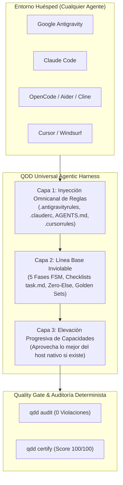

# ADR-0003: Arnés Universal Agnóstico de Agentes con Elevación Progresiva (Universal Agentic Harness & Graceful Elevation)

## 📌 Estado
**Aprobado (SSOT)**

## 🎯 Contexto
El desarrollo de software asistido por Inteligencia Artificial se ejecuta a través de múltiples herramientas, entornos y modelos:
- **Google Antigravity:** Soporta Planning Mode nativo, artefactos interactivos, subagentes reactivos y protocolo Ping-Pong.
- **Claude Code:** Soporta presupuestos de pensamiento (`budget_tokens`), permisos granulares y subagentes CLI.
- **Cursor / Windsurf:** Soporta Shadow Workspaces y GraphRAG de contexto semántico.
- **OpenCode / Aider / Cline / Roo-Code:** Operan mediante archivos abiertos estándar (`AGENTS.md`, `.agentrules`).

Existía el riesgo de que la calidad de desarrollo dependiera de las capacidades del arnés del cliente que ejecuta el modelo. Si un desarrollador usa un entorno simple (OpenCode/Aider), el código podría degradarse si no cuenta con un arnés riguroso.

---

## 🏛️ Decisión Arquitectónica: La Tríada del Arnés Universal

Se establece una arquitectura en 3 capas que garantiza que la calidad sea idéntica y no dependa del cliente utilizado:

---

### 1. Línea Base Inviolable (Self-Contained Minimum Harness)
Si el cliente es simple (ej. OpenCode o Aider):
- QDD gestiona el ciclo completo en disco: crea `task.md` para checklists de tareas largas, `implementation_plan.md` para mitigación de riesgos y `walkthrough.md` para el cierre.
- Aplica las 5 fases del Círculo Virtuoso (Contexto -> Sprint -> Golden Sets -> Código -> Verificación).
- Aplica la prohibición total de sentencias `else` (Zero-Else & Early Return) y la regla de Unicidad del Dato (`CERT-034`).

### 2. Inyección Omnicanal de Reglas
QDD sincroniza automáticamente los perfiles de configuración para todos los agentes reconocidos:
- `.antigravityrules` y `.agents/workflows/` -> Antigravity.
- `.clauderc` y `.claude/commands/` -> Claude Code.
- `.cursorrules` y `.cursor/rules/` -> Cursor IDE.
- `AGENTS.md`, `.agentrules` y `.opencode/` -> OpenCode, Aider, Cline, Roo-Code, Copilot.

### 3. Elevación Progresiva (Graceful Elevation / Best-Harness First)
Si el entorno huésped posee una capacidad nativa superior:
- **En Antigravity:** Se delega la barra lateral de artefactos y el árbol de subagentes reactivos sin polling.
- **En Claude Code:** Se delega el control de permisos y el thinking extendido.
- **En Cursor:** Se delega la edición en Shadow Workspace.
- QDD actúa como el **Juez de Calidad Determinista** ejecutando `qdd audit` y `qdd certify` como gate final.

---

## 🛡️ Consecuencias y Garantías
- **Agnóstico al Modelo/Herramienta:** El desarrollador puede cambiar de Claude a Antigravity o a OpenCode en cualquier momento sin perder trazabilidad ni calidad.
- **Cero Flakiness:** Toda tarea larga se descompone en tareas atómicas con checklist dinámico (`[ ]`, `[/]`, `[x]`).
- **Garantía 100% Determinista:** Ningún código se acepta sin superar la auditoría técnica y la suite de Golden Sets.
