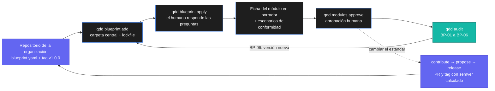

# Blueprints: los estándares de módulo de tu organización

Una organización construye los mismos módulos una y otra vez: usuarios, roles y permisos, notificaciones, auditoría, pagos. Sin un estándar, cada equipo (y cada IA) los resuelve distinto. Un **blueprint** es el esqueleto conceptual de uno de esos módulos, escrito una vez y aplicado en todos los proyectos.

Un blueprint no trae código. Trae decisiones:

| Parte | Qué es | Ejemplo |
|---|---|---|
| **Vocabulario** | Palabras que toda la organización usa igual. | *canal*: medio de entrega (correo, WhatsApp, push). |
| **Preguntas de diseño** | Lo que cada proyecto debe decidir. El blueprint no lo decide por él. | ¿Por qué canales se notifica? |
| **Decisiones** | Lo que implica cada respuesta. | Si es WhatsApp: vía la API oficial. |
| **Invariantes** | Lo que ningún cambio puede romper. | Ninguna notificación incluye secretos. |
| **Escenarios de conformidad** | Casos que toda implementación debe pasar. | El mismo evento procesado dos veces genera una sola notificación. |
| **Referencias** (opcional) | Implementaciones de referencia por stack. | `referencias/go/…` |

QDD es público y solo trae el **mecanismo**: importar, aplicar, vigilar y evolucionar. Los blueprints viven en el repositorio de tu organización (privado o público) y, en tu máquina, en la carpeta central de QDD: el proyecto solo versiona el lockfile. El diseño está en [RFC 0003](../rfcs/0003-blueprints.md), [RFC 0004](../rfcs/0004-blueprints-centrales.md) (carpeta central y ciclo de vida) y [RFC 0007](../rfcs/0007-fuentes-de-blueprints.md) (varias fuentes).



## 1. Crear el repositorio de la organización

Un solo repositorio guarda todos los blueprints. Cada carpeta de primer nivel con un `blueprint.yaml` es un blueprint:

```
org/qdd-blueprints          (privado si quieres)
├── catalogo.yaml           # opcional: paquetes y nombre de la organización
├── notificaciones/
│   ├── blueprint.yaml
│   └── referencias/…       # opcional
└── auditoria/
    └── blueprint.yaml
```

`catalogo.yaml` agrupa blueprints en paquetes que se importan juntos:

```yaml
organizacion: Mi organización
paquetes:
  base: [notificaciones, auditoria]
```

Si el nombre de una carpeta no coincide con el id del blueprint, decláralo con `blueprints: {<id>: <carpeta>}`.

### Escribir un blueprint

Parte de la plantilla [`.qdd/core/templates/blueprint.yaml`](../.qdd/core/templates/blueprint.yaml), que trae todos los campos comentados. Lo esencial:

```yaml
id: notificaciones
nombre: Notificaciones
version: 1.0.0                     # semver
descripcion: Cómo se avisa a las personas de lo que pasa en el producto.

vocabulario:
  - termino: canal
    definicion: Medio de entrega (correo, WhatsApp, push).

preguntas:
  - id: canales
    pregunta: ¿Por qué canales se notifica?
    por_defecto: correo            # sugerencia: nunca se aplica sin preguntar
    opciones:
      - valor: correo
        invariantes: ["Todo correo trae enlace para dejar de recibirlo"]
      - valor: whatsapp
        decisiones: ["WhatsApp vía la API oficial"]
  - id: proveedor
    pregunta: ¿Qué proveedor de WhatsApp?
    si: {canales: whatsapp}        # solo se pregunta si se eligió whatsapp
    opciones:
      - valor: meta
      - valor: otro

ficha:                             # base de la ficha de módulo que se genera
  nombre: Notificaciones
  rutas: [internal/notificaciones] # sugerida; el proyecto la cambia con --ruta
  objetivo_operativo:
    problema: Qué problema resuelve el módulo.
    criterio_de_exito: Cómo se sabe que cumple (medible).
  objetivo_tecnologico:
    arquitectura: Cómo se construye y por qué.
    decisiones: ["Envío asíncrono con reintentos"]
    invariantes: ["Ninguna notificación incluye secretos ni datos sensibles completos"]

conformidad:
  - id: NOT-C01
    titulo: Idempotencia
    cuando: el mismo evento se procesa dos veces
    entonces: la persona recibe una sola notificación
```

Reglas que QDD valida al importar:

- id y valores en minúsculas (números, `-` o `_`);
- `version` en semver;
- al menos dos opciones por pregunta (si no hay alternativa, no es una pregunta: es una invariante);
- `si` solo depende de preguntas anteriores y de valores que existan;
- los ids de escenario no se repiten;
- las `referencias` quedan dentro de la carpeta del blueprint.

En los textos, `{{pregunta}}` se reemplaza por la respuesta del proyecto.

### Versionar

Cada versión es un tag `vX.Y.Z` del repositorio. No lo fijas a mano: `qdd blueprint propose` compara con lo publicado y calcula el cambio (ver [§4](#4-cambiar-o-crear-un-blueprint)):

| Cambio | Versión |
|---|---|
| Redacción, ayudas, vocabulario | patch (`1.0.1`) |
| Opciones o preguntas nuevas | minor (`1.1.0`) |
| Invariantes nuevas o distintas | major (`2.0.0`) |

## 2. Importar en un proyecto

La primera vez indicas el repositorio. QDD lo clona con tus credenciales git, valida los blueprints y registra el repositorio en `.qdd/config.yaml` y en el registro central (los demás proyectos de la organización, con el mismo dueño en su remote git, lo encuentran solos):

```bash
qdd blueprint add git@github.com:org/qdd-blueprints.git --ref v1.0.0 notificaciones
```

```yaml
# .qdd/config.yaml (QDD edita solo esta clave y conserva el resto)
blueprints:
    origen: git@github.com:org/qdd-blueprints.git
    ref: v1.0.0
```

Después basta con los nombres:

```bash
qdd blueprint add auditoria             # uno más, del repositorio registrado
qdd blueprint add --paquete base        # un paquete del catalogo.yaml
qdd blueprint add --todos --ref v1.1.0  # todo, y actualiza el ref registrado
qdd blueprint add                       # lista lo disponible
```

- El contenido vive en la **carpeta central** de QDD (`~/.local/share/qdd/blueprints`, o `$QDD_HOME`), nunca en el proyecto. El proyecto solo versiona `.qdd/blueprints.lock.yaml`, con la fuente, la versión, el commit y la huella de cada blueprint. Commitéalo.
- **Todo o nada:** si uno de los pedidos es inválido, no se importa ninguno, y si una fuente falla el lockfile queda como estaba.
- **Varias fuentes:** puedes sumar tus propios estándares con la URL de otro repositorio (`qdd blueprint add git@github.com:yo/mis-blueprints.git mi-estandar`). El lockfile recuerda la fuente de cada uno y `qdd blueprint add <id>` lo actualiza desde ahí. Un id ya importado desde otra fuente se rechaza, salvo con `--reemplazar`.
- **Repositorios públicos:** se leen por HTTPS sin cuenta ni llave. Si no tienes acceso a una URL SSH, el error te dice su URL HTTPS.
- **La protección es el acceso al repositorio:** quien no tiene acceso no puede importar. QDD bloquea transportes `ext::` e inyección de opciones en git.
- **Otro PC:** `qdd doctor --fix` reconstruye la carpeta central desde el lockfile. Un proyecto con copias del esquema anterior (`.qdd/blueprints/`) se migra igual.

## 3. Aplicar: generar el módulo

```bash
qdd blueprint apply notificaciones --ruta internal/notificaciones \
  --prueba "go test ./internal/notificaciones/..."
```

Con terminal, QDD hace las preguntas una por una (Enter elige la sugerida). Sin terminal, pásalas con `--respuesta`:

```bash
qdd blueprint apply notificaciones --respuesta canales=correo
```

Si falta alguna respuesta, **no escribe nada** y dice cuáles faltan. Las decisiones de diseño nunca se toman por defecto.

Lo que genera:

| Archivo | Contenido |
|---|---|
| `.qdd/project/modules/notificaciones.yaml` | La ficha del módulo en **borrador**, con `blueprint: notificaciones@1.0.0`, las decisiones e invariantes de la base y las de las opciones elegidas. |
| `.qdd/project/goldensets/notificaciones/conformidad.yaml` | Los escenarios de conformidad, para implementarlos como pruebas. |
| `.qdd/project/blueprints/notificaciones.yaml` | Las respuestas del proyecto, la versión y lo que generó el blueprint. |
| `internal/notificaciones/README.md` | Un esqueleto conceptual, solo si la carpeta no existía. Una carpeta existente nunca se toca. |

Volver a aplicarlo (por ejemplo, tras importar una versión nueva) reutiliza las respuestas, pregunta solo lo nuevo y **conserva lo que el proyecto agregó** a la ficha: decisiones e invariantes propias, ADRs, findings, comandos de prueba y caso real.

Por último, un humano revisa y aprueba la ficha:

```bash
qdd modules approve notificaciones
```

## 4. Cambiar o crear un blueprint

Un blueprint nunca se edita en el proyecto: el cambio va a su repositorio, por PR.

```bash
qdd blueprint contribute notificaciones   # rama aporte/notificaciones en un clon de la carpeta central
# … edita el blueprint en la carpeta que te indica …
qdd blueprint propose notificaciones -m "Agrega el canal push"   # valida, calcula la versión, abre el PR
# tras el merge:
qdd blueprint release                     # etiqueta vX.Y.Z en el repositorio
```

- Uno importado se aporta siempre a su fuente; uno nuevo, a la organización o a la de `--origen`.
- `propose` calcula patch, minor o major según lo que cambió; `release` rechaza un blueprint que cambió sin pasar por `propose`.
- Si SSH no tiene permiso de escritura (por ejemplo, una deploy key de solo lectura), `propose` y `release` reintentan por HTTPS con tus credenciales de git.
- Los demás proyectos lo ven en su próximo `qdd audit` como `BP-06-BEHIND`.

## 5. Con una IA

No hace falta usar la CLI. Las reglas que `qdd init` deja en tu IDE (`AGENTS.md`, `.clauderc`, `.cursorrules`…) le enseñan a la IA a usar los blueprints sola:

- Si pides *"agrega el blueprint de notificaciones y auditoría"*, la IA llama a `qdd_blueprint_add`. Si el proyecto no tiene repositorio registrado, te pregunta la URL; nunca la inventa.
- Antes de construir un módulo que un blueprint define, llama a `qdd_blueprint_apply` y **te hace sus preguntas tal cual**. Las respuestas son tuyas, no de la IA.
- `qdd_project_context`, la primera llamada de toda tarea, muestra los estándares de la organización (aplicados o sin aplicar). Si la IA va a tocar una carpeta que coincide con las rutas de un blueprint sin aplicar, le pide aplicarlo en vez de inventar una ficha.
- Las invariantes no se negocian: si una no sirve, la IA prepara el cambio con `qdd_blueprint_contribute` y, con tu confirmación, lo propone con `qdd_blueprint_propose` (QDD fija la versión). Nunca copia ni edita un blueprint dentro del proyecto.

## 5. Vigilar: el gate

`qdd audit` revisa los blueprints en cada corrida. Sin blueprints importados, no reporta nada.

| Regla | Cuándo bloquea | Qué hacer |
|---|---|---|
| `BP-01-INVALID` | Un blueprint, el lockfile o un registro de aplicación no se puede leer o no es válido. | Corrige el blueprint en el repositorio de la organización y vuelve a importarlo. |
| `BP-02-ALTERED` | Lo publicado en el repositorio no coincide con la huella o la versión del lockfile (alguien lo editó a mano). | Vuelve a importarlo desde su fuente; los cambios van por `contribute` → `propose`. |
| `BP-03-OUTDATED` | El módulo se generó con una versión distinta de la importada. | `qdd blueprint apply <id>` otra vez. |
| `BP-04-MISSING` | El módulo se generó desde un blueprint que ya no está importado. | Vuelve a importarlo o quita la referencia de la ficha. |
| `BP-05-LEGACY` | Queda una copia del esquema anterior dentro del proyecto (`.qdd/blueprints/`). | `qdd doctor --fix` la migra a la carpeta central; commitea el resultado. |
| `BP-06-BEHIND` | Su fuente publicó una versión más nueva. | `qdd blueprint add <id>` y vuelve a aplicarlo con `qdd blueprint apply`. |

Las reglas `HEART-*` siguen vigilando que la ficha no quede atrás del código (ver [Reglas del gate](command-reference.md#reglas-del-gate)).

## Pendiente

Lo que todavía no existe está en la sección 5 del [RFC 0003](../rfcs/0003-blueprints.md#5-fase-3-pendiente): verificación de firma de los tags, lista de orígenes permitidos, un registro a nivel de usuario, dependencias entre blueprints y trazabilidad entre escenarios y pruebas.
