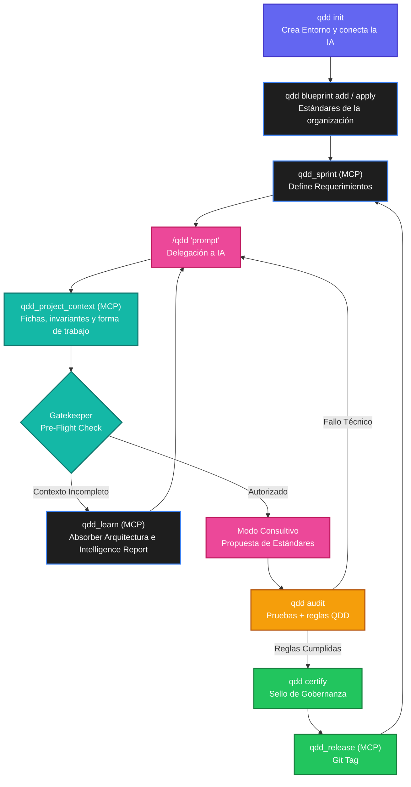

# Command Reference

La interfaz de línea de comandos de QDD (QDD CLI) se divide en dos rutas:
1. **Fast Path**: Comandos deterministas que se ejecutan localmente sin IA.
2. **Cognitive Path (MCP)**: Las *tools* que tu IDE con IA invoca para trabajar bajo las reglas de QDD.

## Mapa del Ciclo de Mejora Continua (Lifecycle)

Este diagrama representa el flujo de trabajo orquestado para mantener la base de código segura, auditable y moderna en un ciclo infinito de integración continua.



## The Safe Boundary: Análisis vs Mutación

En QDD existe una línea estricta que separa **leer/auditar** de **modificar el código**. Los comandos de auditoría están diseñados para ser 100% seguros (Read-Only) y jamás alterarán tu código fuente.

> ⚠️ **Solo los comandos de esta página que NO llevan la etiqueta "(MCP)" existen como subcomandos reales de la CLI** (probá `qdd <comando> --help`). Los que sí la llevan solo existen como *tools* MCP: no funcionan tipeados directo en la terminal — hay que pedirle a un IDE con IA conectado por MCP (Claude Code, Cursor, Antigravity, OpenCode) que las invoque. Ver FND-019.

Todos los comandos funcionan desde cualquier subcarpeta: se ubican solos en la raíz del proyecto.

### 🛡️ Comandos Seguros (Read-Only / Auditoría) — CLI real
Estos comandos puedes ejecutarlos sin miedo directo en la terminal. Su único trabajo es leer tu repositorio y reportar su estado:

| Comando | Descripción |
|---------|-------------|
| `qdd audit` | Revisa el proyecto contra las reglas del framework: corre las pruebas del proyecto y revisa OWASP, Cero `else`, despliegues, fichas y blueprints. Separa los problemas que **bloquean** el gate (exit 1) de las **recomendaciones** (adopción gradual: E2E, ADR, Conventional Commits). Muestra el puntaje QDD. Ver [Reglas del gate](#reglas-del-gate). **Seguro.** |
| `qdd certify` | Audita el proyecto, calcula el puntaje y lo guarda en el historial para medir la tendencia. **Seguro.** |
| `qdd doctor [--fix]` | Verifica que el entorno QDD esté completamente funcional (checklist determinista), incluidos los blueprints de la organización: sin copias en el proyecto, íntegros en la carpeta central, acceso al repositorio y al día. `--fix` migra, reconstruye desde el lockfile (otro PC) y sincroniza; nunca borra copias editadas ni actualiza blueprints por su cuenta. **Seguro.** |
| `qdd report` | Genera el reporte integral y consolidado de auditoría, certificaciones, findings y telemetría en formato Text, Markdown o JSON. **Seguro.** |
| `qdd dashboard` | Inicia el Centro de Comando Web. Despliega el Intelligence Report, métricas, Sprints y Certificaciones. **Seguro.** |
| `qdd evolution` | Estudia findings abiertos, certificaciones pendientes, violaciones de auditoría e historial de score para recomendar la única siguiente mejora accionable. No crea ni certifica nada por sí solo (Modo Consultivo). **Seguro.** |
| `qdd benchmark` | Evalúa la calidad de respuesta (Cognitive Quality) del framework. **Seguro.** |
| `qdd modules` | Lista las fichas de módulo (`.qdd/project/modules/`) con su estado (borrador o aprobada), su desfase respecto del código y las zonas de código que aún no tienen ficha. **Seguro.** Ver [Fichas de módulo](#fichas-de-módulo). |
| `qdd modules context [rutas…]` | Imprime el mismo contexto que recibe una IA con la tool MCP `qdd_project_context`: propósito, forma de trabajo obligatoria, cómo se prueba y la ficha de los módulos de esas rutas. Sirve para IAs sin MCP. **Seguro.** |
| `qdd blueprint list` / `qdd blueprint show <id>` | Lista los blueprints del lockfile (arquetipos de módulo de tu organización) o muestra el vocabulario, las preguntas y las invariantes de uno. También reporta los problemas del gate (`BP-01` a `BP-06`). **Seguro.** Ver RFC 0003 y RFC 0004. |
| `qdd blueprint sync` | Trae lo publicado en cada fuente del proyecto (la organización y las demás del lockfile) y dice qué blueprints tienen una versión más nueva. Una fuente inaccesible se informa sin ocultar las demás. **Seguro.** |
| `qdd mcp-server` | Inicia el servidor MCP de QDD (JSON-RPC sobre stdio). No se usa a mano: `qdd init` lo registra en tu IDE. **Seguro.** |

### ⚡ Comandos de Mutación (Estructurales) — CLI real
Estos comandos modifican el repositorio agregando carpetas o archivos de gobernanza:

| Comando | Descripción |
|---------|-------------|
| `qdd init [--lenguaje L] [--arquitectura A]` | Inicializa el entorno creando el directorio `.qdd/`, `config.yaml`, el **Wisdom Registry** (`manifesto.md`) y las reglas de cada IA (ver [Adaptadores de IA](#adaptadores-de-ia)). Detecta Node, Go, Java/Kotlin, Python, Dart/Flutter, Rust, PHP, Ruby y .NET, también en subcarpetas (monorepo). En un proyecto sin código, declara el stack con las flags. Deja los proyectos nuevos en adopción gradual (`adopcion: gradual` en `policies.yaml`). Crea `./tmp` para lo temporal, ignorada por git con su propio `.gitignore`. Es seguro repetirlo: completa lo vacío y no pisa lo declarado. |
| `qdd run <cmd1> <cmd2>...` | Ejecuta subcomandos de QDD en secuencia como una tubería (ej. `qdd run audit certify`), abortando y revirtiendo (`qdd undo`) si alguno falla. |
| `qdd run --keep-alive <cmd>` | Supervisa un proceso externo (un binario, un servicio) manteniéndolo siempre vivo: lo reinicia en cada salida limpia. Ante un error real, registra un Finding + evidencia y luego invoca a un agente de IA local (Claude, Antigravity o Cursor — el primero disponible) para diagnosticar y aplicar el fix real de forma desatendida (`--dangerously-skip-permissions`), reintentando hasta 3 veces antes de detenerse para revisión humana. Ver ADR-004 (supersede ADR-003). |
| `qdd undo <comando>` | Revierte el efecto de un comando (p. ej. `qdd undo init`). Es lo que usa el rollback de `qdd run`. |
| `qdd bug --command <cmd> [--exit-code N] [--output …] [--title …]` | Registra un error como Finding permanente con estado OPEN y su evidencia (mismo mecanismo que usa `qdd run --keep-alive` internamente). No repara nada: deja el finding con `test_pending` para que se agregue la prueba de regresión. |
| `qdd certify human [target]` | Certifica comportamiento humano, accesibilidad (WCAG 2.2) y usabilidad con el motor DAG del plugin `qdd-human-certifier`, en viewports Desktop (1440x900) y Mobile (390x844). Guarda la evidencia en `.qdd/evidence/run_…`. |
| `qdd modules approve <id>` | Aprobación humana de una ficha de módulo: la marca como aprobada y registra el commit revisado. Desde ahí, `HEART-02` avisa si el código cambia sin actualizar la ficha. |
| `qdd blueprint add [origen] [id…] [--paquete p \| --todos] [--ref vX.Y.Z]` | Importa blueprints de una **versión publicada** (tag `vX.Y.Z`; sin `--ref`, la última) del repositorio git de tu organización, con tus credenciales. La primera vez indicas el repositorio y QDD lo registra en `.qdd/config.yaml` y en el registro central: desde ahí, este y los demás proyectos de la organización (mismo dueño en su remote git) solo nombran los ids. También puedes importar de otras fuentes (p. ej. tu repositorio público) pasando su URL: el lockfile recuerda la fuente de cada blueprint y `add <id>` lo actualiza desde ahí. Un id ya importado desde otra fuente se rechaza salvo con `--reemplazar` (RFC 0007). El contenido vive en la carpeta central de QDD (`~/.local/share/qdd/blueprints`); el proyecto solo versiona `.qdd/blueprints.lock.yaml`. |
| `qdd blueprint contribute <id> [--origen repo]` | Prepara un aporte a un blueprint (existente o nuevo) en la rama `aporte/<id>` de un clon en la carpeta central, nunca en el proyecto. Uno importado va a su fuente; uno nuevo, a la de `--origen` o a la organización. |
| `qdd blueprint propose <id> -m "…" [--origen repo]` | Valida el aporte, **calcula el cambio semver y fija la versión** (major/minor/patch según lo que cambió), commitea, publica la rama y abre el PR con `gh`. |
| `qdd blueprint release [--origen repo]` | Tras el merge, etiqueta el repositorio de la organización, o el de `--origen` (`vX.Y.Z`). Rechaza los blueprints que cambiaron sin pasar por `propose`. |
| `qdd blueprint apply <id…> [--ruta …] [--modulo id] [--respuesta p=v …] [--prueba …]` | Pregunta las decisiones de diseño del blueprint (o las toma de `--respuesta`) y genera la ficha del módulo en **borrador**, sus escenarios de conformidad, el registro de decisiones y, si la carpeta no existe, un esqueleto `README.md`. Al volver a aplicarlo reutiliza las respuestas y conserva lo que el proyecto agregó a la ficha. |

### 🧭 Estado por frente y consola de Claude Code (RFC 0006)
El estado por frente es una tabla de frentes de trabajo por etapas (✅ hecho con evidencia, ⏳ espera algo de alguien, ❌ falla), en `.qdd/project/estado.yaml` (blueprint `estado-por-frente`, destino «archivo»). La consola la muestra en un panel a la derecha de Claude Code (blueprint `consola-claude-code`) y, desde qdd 2.7.0, también en la barra lateral de OpenCode, de solo lectura.

| Comando | Descripción |
|---------|-------------|
| `qdd estado init [--etapas …]` | Crea `.qdd/project/estado.yaml` con las etapas de la ficha (o las de `--etapas`). Es del humano: la IA no lo crea. |
| `qdd estado ver` | Imprime la tabla. **Seguro.** |
| `qdd estado set <frente> <etapa> <estado>` | Crea o actualiza una celda y valida antes de escribir: un ✅ lleva evidencia (commit, versión, n/n pruebas), un ⏳ dice qué espera y de quién, un ❌ nombra la falla. |
| `qdd estado cerrar <frente>` | Cierra (o descarta) un frente con su motivo. Un frente nunca se borra en silencio. |
| `qdd estado check [--respuesta r.md] [--json]` | Lector automático de los escenarios EPF-C01…C07 (y EPF-A01 con `--respuesta`); compara contra git HEAD para detectar frentes que desaparecen. Sale con 1 si hay violaciones. **Seguro.** |
| `qdd estado watch` | Panel en vivo en la terminal, con la tabla, lo que espera cada ⏳ y las fallas (`q` o Ctrl-C para salir). **Seguro.** |
| `qdd estado activa <tarea> [--fin] [--quien texto]` | Declara la tarea en curso (el panel la marca «● running»); con `--fin` la apaga. Se apaga sola a los 120 s sin pulsos. (qdd 2.7.0) |
| `qdd estado pulso [<tarea>] [--fuente agente\|subagente\|comando]` | Señal de vida de la tarea en curso; sin tarea, late la última activada. Sin tarea en curso no imprime nada y sale con 0. **Seguro.** (qdd 2.7.0) |
| `qdd estado statusline` | Resumen de una línea para una barra de estado; sin archivo no imprime nada y nunca falla. **Seguro.** |
| `qdd consola activar [--recursos]` | Instala en Claude Code (alcance de usuario) el panel de QDD y la barra; si OpenCode está en la máquina, también su panel de solo lectura; con `--recursos`, la barra muestra disco, GPU, RAM y CPU. Una barra propia no se reemplaza sin dejar copia. Nada se escribe en el proyecto. |
| `qdd consola actualizar` / `qdd consola desactivar` | Deja el panel en la versión de esta CLI, o lo quita y devuelve la barra anterior. |
| `qdd consola estado` | Dice si la consola está activa y al día. **Seguro.** |
| `qdd consola panel` | Lo que dibuja el panel, en JSON (estado por frente y acciones). Nunca falla. **Seguro.** |
| `qdd consola accion <id> [--confirmado]` | Ejecuta una acción que ofrece el panel (aprobar una ficha, revisar el estado, auditar, un comando pedido). Lo que escribe corre solo con `--confirmado`, que el panel pasa después de «s  Sí». |
| `qdd consola statusline` | La barra de estado de Claude Code (lee su JSON por la entrada estándar). Nunca falla. **Seguro.** |
| `qdd consola pedir -m <motivo> [--carpeta dir] <comando…>` | Deja en «▶ Para ti» del panel un comando para que **la persona** lo ejecute con un clic (p. ej. el push de un tag). QDD no lo ejecuta: corre solo después de «s  Sí», en su carpeta. Un pedido aceptado queda en gris y no se acepta dos veces. |
| `qdd consola pedidos` | Lista los comandos pedidos con su tecla y su estado (pendiente, ⟳ ejecutando, ✓ hecho, falló). **Seguro.** |
| `qdd consola descartar <id>` | Quita un comando pedido sin ejecutarlo. |

### 🤖 Solo vía MCP — pedile a tu IDE con IA que las invoque
Estas *tools* existen y funcionan, pero únicamente a través del servidor MCP — tipear `qdd learn` (por ejemplo) en una terminal no hace nada útil:

**Contexto, fichas y blueprints**

| Tool MCP | Descripción |
|---------|-------------|
| `qdd_project_context` | **Primera llamada de toda tarea.** Recibe las rutas que la IA va a tocar y devuelve el propósito del proyecto, la forma de trabajo obligatoria, cómo se prueba, la ficha completa de esos módulos (con aviso si está en borrador o desfasada), los estándares de la organización (blueprints aplicados o sin aplicar), el mapa de módulos y las zonas sin ficha. |
| `qdd_module_save` | La IA propone o actualiza una ficha de módulo. Se valida contra el esquema y **siempre queda en borrador**: solo un humano la aprueba (`qdd modules approve`). |
| `qdd_blueprint_add` | Importa blueprints del repositorio registrado de la organización cuando el humano lo pide ("agrega auth y auditoría"). Sin registro, la IA debe preguntar la URL, nunca inventarla. |
| `qdd_blueprint_list` | Muestra los blueprints importados con su vocabulario, preguntas e invariantes, para que la IA construya el módulo según el estándar de la organización. |
| `qdd_blueprint_apply` | Igual que `qdd blueprint apply`. Si faltan decisiones, devuelve las preguntas sin escribir nada: la IA debe hacérselas al humano, no responderlas. |
| `qdd_blueprint_sync` | Igual que `qdd blueprint sync`, para cuando el gate reporta `BP-06-BEHIND`: un resultado por fuente. |
| `qdd_blueprint_contribute` | Igual que `qdd blueprint contribute`: devuelve la carpeta central donde la IA edita el blueprint. |
| `qdd_blueprint_propose` | Igual que `qdd blueprint propose`. Publica fuera del proyecto: la IA solo la usa con confirmación del humano. |
| `qdd_learn` | Explora el código base para asimilar arquitecturas e invoca a la IA para redactar/refinar el **Intelligence Report** (`.qdd/understanding.json`) — incremental desde FND-020. |

**Gate, estado y conocimiento**

| Tool MCP | Descripción |
|---------|-------------|
| `qdd_estado` | Estado por frente: `accion=ver` al retomar una sesión (seguir desde los ⏳), `set` al avanzar (antes de reportar), `cerrar` con motivo y `check` para el lector automático; desde qdd 2.7.0, `activar`, `pulso` y `terminar` para la tarea en curso. Las escrituras se validan: si violan una regla, no se escribe nada. |
| `qdd_consola_pedir` | Deja un comando en el panel para que la persona lo ejecute (comando, motivo y carpeta). Para lo que la IA no puede o no debe ejecutar, como publicar; la IA nunca lo ejecuta ella misma con `qdd consola accion`. |
| `qdd_audit` | Lo mismo que `qdd audit`, para que la IA verifique su propio trabajo antes de proponer un commit. |
| `qdd_certify` | Lo mismo que `qdd certify`. |
| `qdd_status` | Panel de control. Escanea el repositorio para mostrar certificaciones activas y *Findings* (bugs) abiertos. |
| `qdd_score` | Calcula el puntaje de calidad (el mismo de `qdd audit`, `certify`, `evolution` y `report`) y resume certificaciones y findings. |
| `qdd_findings` | Lista los findings del proyecto con su estado. |
| `qdd_evolution` | Misma lógica que el comando CLI `qdd evolution`, disponible también para que la IA la invoque. |
| `qdd_report` | Genera el reporte integral de gobernanza y auditoría en formato Text, Markdown o JSON. |
| `qdd_map` | Genera el mapa topológico de certificación del proyecto (`.qdd/project/topology.json`). |
| `qdd_query_graph` | Ejecuta SQL de solo lectura sobre el grafo de conocimiento (`.qdd/knowledge.db`, tablas `nodes` y `edges`). |
| `qdd_graph_query` | En desarrollo: hoy solo confirma que recibió la consulta. Usa `qdd_query_graph`. |
| `qdd_sync_graph` | Fuerza la sincronización del grafo de conocimiento (`.qdd/knowledge.db`). |

**Flujo de trabajo**

| Tool MCP | Descripción |
|---------|-------------|
| `qdd_sprint <n>` | Crea la plantilla de trabajo para una nueva iteración en `.qdd/project/sprints/`. Exige Happy Path y Error Paths. |
| `qdd_release <version>` | Compila, actualiza la versión en `state.json`, y crea un Git Tag **local** (no hace push ni publica). |
| `qdd_sync` | Sincroniza las reglas nativas y el Manifiesto con los adaptadores de IA de forma idempotente. |
| `qdd_harness_generate` | Genera el system prompt combinado (Agentic Harness) para el IDE conectado. |
| `qdd_certify_human` | Igual que `qdd certify human`: `target` puede ser `all`, una categoría (`usability`, `accessibility`, `resilience`, `auth`) o un nodo (`auth:login_nominal`). |
| `qdd_resolve_diagnose` | Diagnóstico forense integral de incidentes para el Equipo Resolutor FAANG. |
| `qdd_resolve_certify` | Valida y emite el certificado de resolución firmado tras solucionar un incidente. |

**IA, modelos y especialistas**

| Tool MCP | Descripción |
|---------|-------------|
| `qdd_ai_risk_assess` | Evalúa riesgos de modelos y mitigaciones bajo ISO/IEC 23894 e ISO/IEC 42001. |
| `qdd_ai_test_integrity` | Ejecuta y valida Golden Sets deterministas bajo ISO/IEC 29119-11 y SOC 2. |
| `qdd_local_llm_status` | Sondea y reporta el estado de APIs locales de LLM (Antigravity, Ollama, LM Studio, Claude). |
| `qdd_local_llm_exec` | Ejecuta instrucciones bajo gobernanza en el motor cognitivo local activo. |
| `qdd_postgres_tuner` | Analiza una consulta SQL lenta de PostgreSQL y propone optimizaciones (índices, parámetros). |

### 🚧 Documentados pero no implementados (roadmap, no lo intentes en la CLI ni por MCP)
Estos aparecían en versiones previas de esta misma página describiendo funcionalidad que nunca se construyó — no existen como subcomandos ni como tools: `qdd validate`, `qdd review`, `qdd ui`, `qdd api`, `qdd db`, `qdd docs`, `qdd sync-ai`. Si tu caso de uso necesita alguno, es una propuesta de feature nueva, no un comando que puedas invocar ya. (Los `/qdd <comando>` que aparecen en `AGENTS.md` son instrucciones para la IA, no subcomandos de la CLI.)

## Fichas de módulo

Una ficha (`.qdd/project/modules/<id>.yaml`) es el "corazón" de un módulo: su objetivo operativo (problema, usuarios, criterio de éxito, caso real), su objetivo tecnológico (arquitectura, decisiones, invariantes), cómo se prueba, sus ADRs y findings. Plantilla: `.qdd/core/templates/module.yaml`.

```bash
qdd modules                         # qué fichas hay, cuáles están desfasadas y qué código no tiene ficha
qdd modules context internal/pagos  # lo que la IA recibe antes de tocar esa carpeta
qdd modules approve pagos           # un humano aprueba la ficha que propuso la IA
```

El ciclo es siempre el mismo: la IA propone (`qdd_module_save`, en borrador), un humano aprueba (`qdd modules approve`), y el gate vigila que la ficha no quede atrás del código (`HEART-02`). Una ficha también puede nacer de un [blueprint](blueprints.md) con `qdd blueprint apply`.

## Reglas del gate

`qdd audit` (y `qdd_audit`) termina con código distinto de cero si algo bloquea. Además de las reglas de código (Cero `else`, OWASP, Clean Code, Unicidad del Dato…), revisa:

| Regla | Qué detecta | Política |
|---|---|---|
| `QA-00-NO-TEST-COMMAND` | No hay cómo correr las pruebas. Decláralas en `.qdd/config.yaml` (`test_commands: ["…"]`). | siempre |
| `QA-01-ALL-TESTS-PASS` | Las pruebas del proyecto fallan o no compilan. | siempre |
| `QA-02-E2E-TESTS` | No hay pruebas E2E. | recomendación en adopción gradual |
| `CI-01-UNGATED-DEPLOY` | Un pipeline despliega sin depender de un job de pruebas (GitHub Actions, Azure, GitLab, Bitbucket). | `deploy_gate` (activa por defecto) |
| `CI-02-DEPLOY-IGNORES-FAILURES` | Un pipeline despliega aunque las pruebas fallen (`succeededOrFailed`, `\|\| true`). | `deploy_gate` |
| `HEART-01-INVALID-RECORD` | Una ficha de módulo no es válida. | siempre |
| `HEART-02-STALE-RECORD` | El código del módulo cambió después de aprobar su ficha. | `module_heart: true` |
| `HEART-03-ZONE-WITHOUT-RECORD` | Hay una zona de código sin ficha. | `module_heart: true` |
| `BP-01-INVALID` | Un blueprint importado, el lockfile o un registro de aplicación no es válido. | con blueprints |
| `BP-02-ALTERED` | Lo publicado en el repositorio no coincide con la huella o la versión del lockfile (alguien lo editó a mano). | con blueprints |
| `BP-03-OUTDATED` | El módulo se generó con otra versión del blueprint; hay que volver a aplicarlo. | con blueprints |
| `BP-04-MISSING` | El módulo se generó desde un blueprint que ya no está importado. | con blueprints |
| `BP-05-LEGACY` | Queda una copia del esquema anterior dentro del proyecto (`.qdd/blueprints/`); `qdd doctor --fix` la migra. | con blueprints |
| `BP-06-BEHIND` | La fuente del blueprint publicó una versión más nueva; `qdd blueprint add <id>` y volver a aplicarlo. | con blueprints |
| `VER-01-INVALID-SEMVER` | La versión declarada (`package.json`, `pyproject.toml`, `Cargo.toml`, `VERSION`) no es `MAJOR.MINOR.PATCH`. | `versioning` (activa por defecto) |
| `VER-02-VERSION-REGRESSION` | La versión declarada es menor que un tag ya publicado. | `versioning` |
| `VER-03-UNDERSIZED-BUMP` | El salto no cubre los cambios desde el último tag (Conventional Commits): un `feat` exige MINOR; `!` o `BREAKING CHANGE:`, MAJOR (MINOR en `0.y.z`). Dice la versión que corresponde. | `versioning` |
| `VER-04-CHANGELOG-MISSING` | El CHANGELOG documenta versiones y le falta la entrada de la nueva. | `versioning` |

Las políticas se configuran en `.qdd/policies.yaml`. Con `adopcion: gradual` (lo que deja `qdd init` en un proyecto nuevo), las prácticas de madurez se muestran como recomendaciones: restan 2 puntos y no bloquean. Cada problema que bloquea resta 10. Para exigirlo todo: `adopcion: estricta`.

## Adaptadores de IA

`qdd init` (y la tool `qdd_sync`) deja las reglas de QDD y el servidor MCP listos para cada asistente:

| Asistente | Archivos |
|---|---|
| Claude Code | `.clauderc`, `.claude/commands/qdd.md` |
| Cursor | `.cursorrules`, `.cursor/mcp.json` |
| Antigravity | `.antigravityrules`, `.agents/workflows/qdd.md`, `.agents/workflows/equipo_resolutor.md` |
| OpenCode y agentes genéricos | `AGENTS.md`, `.agentrules`, `.opencode/qdd.md` |

Esas reglas le exigen a la IA llamar a `qdd_project_context` antes de cambiar código, trabajar con pruebas primero, registrar cada bug como finding, aplicar los blueprints de la organización y no commitear sin pasar el gate.

## Cognitive Path (Pipeline Inteligente vía MCP)

El motor cognitivo interno del CLI ha sido deprecado. En su lugar, QDD actúa como un **Servidor MCP** que transfiere su gobernanza directamente a tu IDE (Cursor, Claude Code, Antigravity, OpenCode).

Para invocar a la Inteligencia Artificial bajo el amparo de QDD, utiliza los comandos integrados de tu IDE:

```bash
/qdd "agrega autenticación a la API"
/qdd "resuelve la deuda técnica en el validador"
```

### 🧠 Capacidades del Ecosistema MCP
- **Contexto antes que código**: `qdd_project_context` le entrega a la IA la ficha, las invariantes y la forma de trabajo del módulo antes de que lo toque.
- **Estándares de la organización**: si el módulo que se va a construir lo define un blueprint, la IA lo aplica y le hace al humano sus preguntas de diseño; no las responde ella.
- **Modo Consultivo (Production-First)**: El framework inyecta reglas que prohíben a la IA ser un "generador de código ciego". Si pides algo que requiera certificación (ej. Autenticación), la IA te propondrá un estándar (ej. OWASP ASVS) y solicitará tu aprobación antes de implementar, gracias a las políticas del MCP.
- **Guardián (Gatekeeper)**: Las herramientas de MCP (`qdd_audit`, `qdd_certify`) abortarán la misión si el código generado por la IA no cumple los estándares estrictos (ej. pruebas que fallan o uso de `else`).
- **Detección de Intención y Riesgo**: A través de las *tools* expuestas, la IA evalúa si tu petición romperá la retrocompatibilidad antes de programar.
