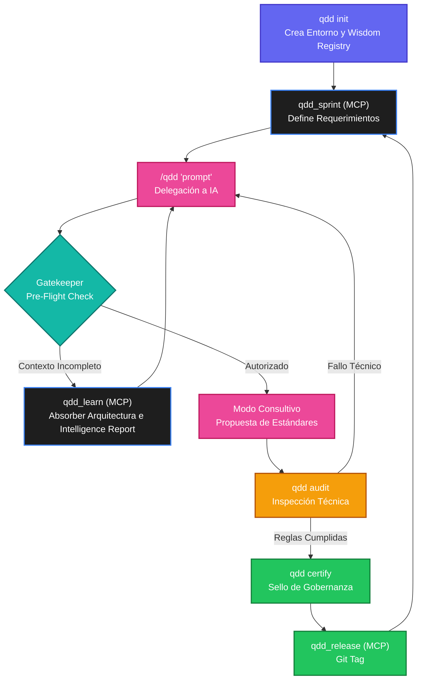

# Command Reference

La interfaz de línea de comandos de QDD (QDD CLI) se divide en dos rutas:
1. **Fast Path**: Comandos deterministas que se ejecutan localmente sin IA.
2. **Cognitive Path (QCL)**: El motor inteligente y consultivo para certificar, auditar o arreglar código.

## Mapa del Ciclo de Mejora Continua (Lifecycle)

Este diagrama representa el flujo de trabajo orquestado para mantener la base de código segura, auditable y moderna en un ciclo infinito de integración continua.



## The Safe Boundary: Análisis vs Mutación

En QDD existe una línea estricta que separa **leer/auditar** de **modificar el código**. Los comandos de auditoría están diseñados para ser 100% seguros (Read-Only) y jamás alterarán tu código fuente.

> ⚠️ **Solo los comandos de esta página que NO llevan la etiqueta "(MCP)" existen como subcomandos reales de la CLI** (probá `qdd <comando> --help`). Los que sí la llevan solo existen como *tools* MCP: no funcionan tipeados directo en la terminal — hay que pedirle a un IDE con IA conectado por MCP (Claude Code, Cursor, Antigravity) que las invoque. Ver FND-019.

### 🛡️ Comandos Seguros (Read-Only / Auditoría) — CLI real
Estos comandos puedes ejecutarlos sin miedo directo en la terminal. Su único trabajo es leer tu repositorio y reportar su estado:

| Comando | Descripción |
|---------|-------------|
| `qdd audit` | Revisa el proyecto contra las reglas del framework (pruebas, OWASP, Cero `else`, despliegues…). Separa los problemas que **bloquean** el gate (exit 1) de las **recomendaciones** (adopción gradual: E2E, ADR, Conventional Commits). Muestra el puntaje QDD. **Seguro.** |
| `qdd certify` | Audita el proyecto, calcula el puntaje y lo guarda en el historial para medir la tendencia. **Seguro.** |
| `qdd doctor [--fix]` | Verifica que el entorno QDD esté completamente funcional (checklist determinista), incluidos los blueprints de la organización: sin copias en el proyecto, íntegros en la carpeta central, acceso al repositorio y al día. `--fix` migra, reconstruye desde el lockfile (otro PC) y sincroniza; nunca borra copias editadas ni actualiza blueprints por su cuenta. **Seguro.** |
| `qdd report` | Genera el reporte integral y consolidado de auditoría, certificaciones, findings y telemetría en formato Text, Markdown o JSON. **Seguro.** |
| `qdd dashboard` | Inicia el Centro de Comando Web. Despliega el Intelligence Report, métricas, Sprints y Certificaciones. **Seguro.** |
| `qdd evolution` | Estudia findings abiertos, certificaciones pendientes, violaciones de auditoría e historial de score para recomendar la única siguiente mejora accionable. No crea ni certifica nada por sí solo (Modo Consultivo). **Seguro.** |
| `qdd benchmark` | Evalúa la calidad de respuesta (Cognitive Quality) del framework. **Seguro.** |
| `qdd blueprint list` / `show <id>` | Lista los blueprints del lockfile (arquetipos de módulo de tu organización) o muestra el vocabulario, las preguntas y las invariantes de uno. También reporta los problemas del gate (`BP-01` a `BP-06`). **Seguro.** Ver RFC 0003 y RFC 0004. |
| `qdd blueprint sync` | Trae lo publicado en cada fuente del proyecto (la organización y las demás del lockfile) y dice qué blueprints tienen una versión más nueva. Una fuente inaccesible se informa sin ocultar las demás. **Seguro.** |

### ⚡ Comandos de Mutación (Estructurales) — CLI real
Estos comandos modifican el repositorio agregando carpetas o archivos de gobernanza:

| Comando | Descripción |
|---------|-------------|
| `qdd init [--lenguaje L] [--arquitectura A]` | Inicializa el entorno creando el directorio `.qdd/`, `config.yaml`, y lo más importante, el **Wisdom Registry** (`manifesto.md`). Detecta Node, Go, Java/Kotlin, Python, Dart/Flutter, Rust, PHP, Ruby y .NET, también en subcarpetas (monorepo). En un proyecto sin código, declara el stack con las flags. Deja los proyectos nuevos en adopción gradual (`adopcion: gradual` en `policies.yaml`). Es seguro repetirlo: completa lo vacío y no pisa lo declarado. |
| `qdd run <cmd1> <cmd2>...` | Ejecuta subcomandos de QDD en secuencia como una tubería (ej. `qdd run audit certify`), abortando y revirtiendo (`qdd undo`) si alguno falla. |
| `qdd run --keep-alive <cmd>` | Supervisa un proceso externo (un binario, un servicio) manteniéndolo siempre vivo: lo reinicia en cada salida limpia. Ante un error real, registra un Finding + evidencia y luego invoca a un agente de IA local (Claude, Antigravity o Cursor — el primero disponible) para diagnosticar y aplicar el fix real de forma desatendida (`--dangerously-skip-permissions`), reintentando hasta 3 veces antes de detenerse para revisión humana. Ver ADR-004 (supersede ADR-003). |
| `qdd bug` | Registra manualmente un error como Finding permanente con evidencia asociada (mismo mecanismo que usa `qdd run --keep-alive` internamente). |
| `qdd blueprint add [origen] [id…] [--paquete p \| --todos] [--ref vX.Y.Z]` | Importa blueprints de una **versión publicada** (tag `vX.Y.Z`; sin `--ref`, la última) del repositorio git de tu organización, con tus credenciales. La primera vez indicas el repositorio y QDD lo registra en `.qdd/config.yaml` y en el registro central: desde ahí, este y los demás proyectos de la organización (mismo dueño en su remote git) solo nombran los ids. También puedes importar de otras fuentes (p. ej. tu repositorio público) pasando su URL: el lockfile recuerda la fuente de cada blueprint y `add <id>` lo actualiza desde ahí. Un id ya importado desde otra fuente se rechaza salvo con `--reemplazar` (RFC 0007). El contenido vive en la carpeta central de QDD (`~/.local/share/qdd/blueprints`); el proyecto solo versiona `.qdd/blueprints.lock.yaml`. |
| `qdd blueprint contribute <id> [--origen repo]` | Prepara un aporte a un blueprint (existente o nuevo) en la rama `aporte/<id>` de un clon en la carpeta central, nunca en el proyecto. Uno importado va a su fuente; uno nuevo, a la de `--origen` o a la organización. |
| `qdd blueprint propose <id> -m "…" [--origen repo]` | Valida el aporte, **calcula el cambio semver y fija la versión** (major/minor/patch según lo que cambió), commitea, publica la rama y abre el PR con `gh`. |
| `qdd blueprint release [--origen repo]` | Tras el merge, etiqueta el repositorio de la organización, o el de `--origen` (`vX.Y.Z`). Rechaza los blueprints que cambiaron sin pasar por `propose`. |
| `qdd blueprint apply <id> [--ruta …] [--respuesta p=v …] [--prueba …]` | Pregunta las decisiones de diseño del blueprint (o las toma de `--respuesta`) y genera la ficha del módulo en **borrador**, sus escenarios de conformidad, el registro de decisiones y, si la carpeta no existe, un esqueleto `README.md`. Al volver a aplicarlo reutiliza las respuestas y conserva lo que el proyecto agregó a la ficha. |

### 🤖 Solo vía MCP — pedile a tu IDE con IA que las invoque
Estas *tools* existen y funcionan, pero únicamente a través del servidor MCP — tipear `qdd learn` (por ejemplo) en una terminal no hace nada útil:

| Tool MCP | Descripción |
|---------|-------------|
| `qdd_blueprint_add` | Importa blueprints del repositorio registrado de la organización cuando el humano lo pide ("agrega auth y auditoría"). Sin registro, la IA debe preguntar la URL. |
| `qdd_blueprint_list` | Muestra los blueprints importados con su vocabulario, preguntas e invariantes, para que la IA construya el módulo según el estándar de la organización. |
| `qdd_blueprint_apply` | Igual que `qdd blueprint apply`. Si faltan decisiones, devuelve las preguntas sin escribir nada: la IA debe hacérselas al humano, no responderlas. |
| `qdd_blueprint_sync` | Igual que `qdd blueprint sync`, para cuando el gate reporta `BP-06-BEHIND`: un resultado por fuente. |
| `qdd_blueprint_contribute` | Igual que `qdd blueprint contribute`: devuelve la carpeta central donde la IA edita el blueprint. |
| `qdd_blueprint_propose` | Igual que `qdd blueprint propose`. Publica fuera del proyecto: la IA solo la usa con confirmación del humano. |
| `qdd_learn` | Explora el código base para asimilar arquitecturas e invoca a la IA para redactar/refinar el **Intelligence Report** (`.qdd/understanding.json`) — incremental desde FND-020. |
| `qdd_status` | Panel de control. Escanea el repositorio para mostrar certificaciones activas y *Findings* (bugs) abiertos. |
| `qdd_score` | Calcula tu calificación de calidad matemática (Ej: 100/100 World-Class). |
| `qdd_sprint <n>` | Crea la plantilla de trabajo para una nueva iteración en `.qdd/project/sprints/`. |
| `qdd_release <version>` | Compila, actualiza la versión en `state.json`, y crea un Git Tag **local** (no hace push ni publica). |
| `qdd_sync` | Sincroniza las reglas nativas y el Manifiesto con los adaptadores de IA (Cursor, Claude Code, Antigravity) de forma idempotente. |
| `qdd_findings` | Lista los findings del proyecto con su estado. |
| `qdd_evolution` | Misma lógica que el comando CLI `qdd evolution`, disponible también para que la IA la invoque. |
| `qdd_map` | Genera el mapa topológico de certificación del proyecto (`.qdd/project/topology.json`). |
| `qdd_query_graph` | Ejecuta SQL de solo lectura sobre el grafo de conocimiento (`.qdd/knowledge.db`). |
| `qdd_harness_generate` | Genera el system prompt combinado (Agentic Harness) para el IDE conectado. |
| `qdd_report` | Genera el reporte integral de gobernanza y auditoría en formato Text, Markdown o JSON. |
| `qdd_resolve_diagnose` | Diagnóstico forense integral de incidentes para el Equipo Resolutor FAANG. |
| `qdd_resolve_certify` | Valida y emite el certificado de resolución firmado tras solucionar un incidente. |
| `qdd_ai_risk_assess` | Evalúa riesgos de modelos y mitigaciones bajo ISO/IEC 23894 e ISO/IEC 42001. |
| `qdd_ai_test_integrity` | Ejecuta y valida Golden Sets deterministas bajo ISO/IEC 29119-11 y SOC 2. |
| `qdd_local_llm_status` | Sondea y reporta el estado de APIs locales de LLM (Antigravity, Ollama, LM Studio, Claude). |
| `qdd_local_llm_exec` | Ejecuta instrucciones bajo gobernanza en el motor cognitivo local activo. |

### 🚧 Documentados pero no implementados (roadmap, no lo intentes en la CLI ni por MCP)
Estos aparecían en versiones previas de esta misma página describiendo funcionalidad que nunca se construyó — no existen en ninguna forma hoy: `qdd validate`, `qdd review`, `qdd ui`, `qdd api`, `qdd db`, `qdd docs`, `qdd sync-ai`. Si tu caso de uso necesita alguno, es una propuesta de feature nueva, no un comando que puedas invocar ya.

## Cognitive Path (Pipeline Inteligente vía MCP)

El motor cognitivo interno del CLI ha sido deprecado. En su lugar, QDD actúa como un **Servidor MCP** que transfiere su gobernanza directamente a tu IDE (Cursor, Claude Code, Antigravity).

Para invocar a la Inteligencia Artificial bajo el amparo de QDD, utiliza los comandos integrados de tu IDE:

```bash
/qdd "agrega autenticación a la API"
/qdd "resuelve la deuda técnica en el validador"
```

### 🧠 Capacidades del Ecosistema MCP
- **Modo Consultivo (Production-First)**: El framework inyecta reglas que prohíben a la IA ser un "generador de código ciego". Si pides algo que requiera certificación (ej. Autenticación), la IA te propondrá un estándar (ej. OWASP ASVS) y solicitará tu aprobación antes de implementar, gracias a las políticas del MCP.
- **Guardián (Gatekeeper)**: Las herramientas de MCP (`qdd_audit`, `qdd_certify`) abortarán la misión si el código generado por la IA no cumple los estándares estrictos (ej. uso de `else`).
- **Detección de Intención y Riesgo**: A través de las *tools* expuestas, la IA evalúa si tu petición romperá la retrocompatibilidad antes de programar.
