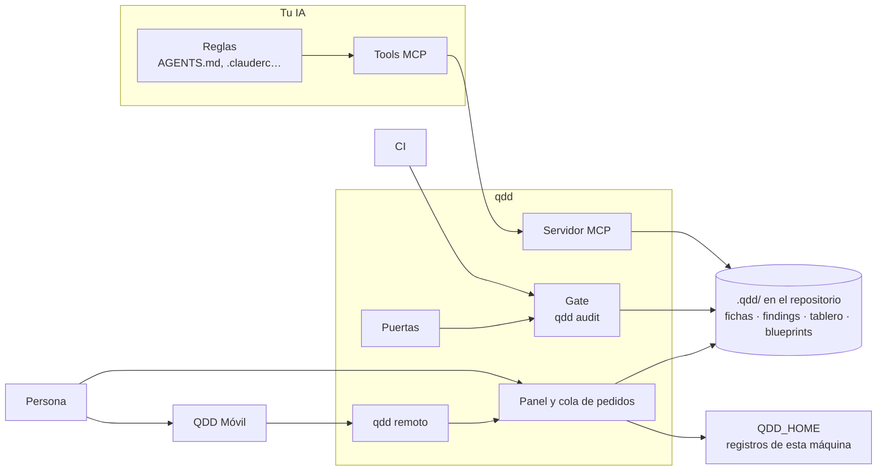

# Arquitectura

QDD es un binario en Go con tres caras: un **CLI** para la persona y el CI, un **servidor MCP** para la IA y un **panel**
que muestra el trabajo y junta las decisiones de la persona. Todo lo que sabe de un proyecto vive en archivos dentro de
`.qdd/`, versionados con el código.

## Qué obliga y qué solo orienta

Es la distinción más importante de QDD.

| Pieza | ¿Obliga? | Cómo |
|---|---|---|
| **`qdd audit` en el CI** | Sí | Sale con 1 si algo bloquea. Es el juez final si tu rama exige ese check |
| **Hooks de git de las puertas** | Sí, en esa máquina | `pre-commit` y `commit-msg` rechazan el commit. Una persona puede saltarlos con `--no-verify` |
| **Puertas del panel en Claude Code** | Sí, a la IA | Rechazan la edición o el comando antes de que corra, también un `--no-verify` de la IA |
| **Pedidos y permisos del baúl** | Sí | Corren solo con el «Sí» de la persona, en el panel, el teléfono o su terminal |
| **Tools MCP** | No | Entregan contexto y resultados. Ninguna detiene a la IA por sí misma |
| **Reglas y método** (`AGENTS.md`, manifiesto, principios) | No | Son instrucciones. Una IA puede no seguirlas; por eso existen las filas de arriba |

Una puerta que no puede decidir (sin qdd, con un error o después de 2 s) deja pasar la acción y lo anota: nunca bloquea por
una falla propia.

## El conocimiento

| Carpeta o archivo | Qué guarda |
|---|---|
| `.qdd/core/wisdom/` | El manifiesto y los principios de ingeniería |
| `.qdd/core/certification/`, `.qdd/project/certification/` | Estándares declarados, del framework y del proyecto. Son documentación con estado: **no cambian el puntaje ni el gate**; `qdd evolution` los usa para recomendar |
| `.qdd/project/modules/` | Las fichas de módulo |
| `.qdd/project/findings/` | Cada bug, con su causa, su arreglo y la prueba que lo cubre |
| `.qdd/project/estado.yaml` | El tablero: tareas por etapas, objetivos y dependencias |
| `.qdd/project/flujos/` | Los flujos, con su historial y sus versiones |
| `.qdd/project/adr/` y `docs/adr/` | Decisiones de arquitectura. La regla `CERT-030-MANDATORY-ADR` mira `docs/adr/` |
| `.qdd/project/sprints/` | Sprints y su contrato de escenarios |
| `.qdd/project/evidence/`, `metrics/` | Reportes, horas de uso, historial del puntaje |
| `.qdd/blueprints.lock.yaml`, `.qdd/project/blueprints/` | Qué versión de cada estándar usa el proyecto y con qué respuestas |
| `.qdd/herramientas/`, `.qdd/ambientes.yaml` | Herramientas del panel y ambientes |

`.qdd/project/` nunca lleva código de la aplicación: solo lo que se sabe de él. Lo que es de la máquina (cola de pedidos,
registro de proyectos, credenciales de QDD Móvil, horas de uso) queda en `QDD_HOME`, por defecto `~/.local/share/qdd`, fuera
del repositorio.

## Fichas de módulo

Una ficha dice *para qué* existe cada parte del sistema:

- **Objetivo operativo**: el problema, para quién, cómo se mide el éxito y el caso real que lo motivó.
- **Objetivo tecnológico**: la arquitectura, las decisiones vigentes y las **invariantes**, lo que ningún cambio puede romper.
- **Cómo se prueba**: los comandos exactos. Cada invariante lleva un id y las pruebas la citan con
  `contrato: <ficha>#<id>`; `HEART-04-INVARIANTE-SIN-PRUEBA` nombra las que nadie demuestra.

El ciclo:

1. Antes de cambiar código, la IA pide `qdd_project_context` con las rutas que va a tocar.
2. Si un módulo no tiene ficha, la propone con `qdd_module_save`. Siempre queda en **borrador**.
3. Una persona la aprueba (`qdd modules approve`), que registra el commit revisado. En modo goal, que solo enciende una
   persona, la aprueba QDD y queda anotado.
4. Con `module_heart: true`, `HEART-02` avisa cuando el código cambió después de la aprobación y `HEART-03` nombra las zonas
   de código sin ficha.

## Blueprints

Un **blueprint** es el estándar de un módulo que tu organización repite: vocabulario, preguntas de diseño, decisiones,
invariantes y escenarios. QDD trae solo el mecanismo; el contenido vive en el repositorio de cada organización. Aplicarlo
genera una ficha en borrador, y el gate vigila que no se altere, no quede atrás y tenga una prueba por escenario (`BP-01` a
`BP-08`). Guía: [Blueprints](blueprints.md). Diseño: [RFC 0003](../rfcs/0003-blueprints.md) y
[RFC 0004](../rfcs/0004-blueprints-centrales.md).

## El gate

`qdd audit` es determinista: no llama a un modelo. Funciona sin red; con red consulta además un catálogo público, con un
tope de 2 s y una caché de un día.

- **Pruebas primero en importancia, no en orden.** Las reglas corren antes y, si una bloquea, las pruebas esperan. Una suite
  que declara sus `rutas` no se repite si ya pasó con esos archivos ([RFC 0020](../rfcs/0020-probar-solo-lo-necesario.md)).
- **Principios con detector.** Cada regla pertenece a un principio (`cli/pkg/audit/principios.yaml`). Si en una parte del
  proyecto ningún detector puede verificarlo, sale como no evaluado ([RFC 0005](../rfcs/0005-reglas-como-principios.md)).
  Hoy los detectores de código leen solo Go.
- **Un solo puntaje.** Parte en 100, resta 10 por cada problema que bloquea y 2 por cada recomendación.
- **Políticas.** `.qdd/policies.yaml` decide qué se revisa y con qué severidad
  ([lista](command-reference.md#políticas)).

## El servidor MCP

`qdd mcp-server` expone unas 35 herramientas por stdio, así que cualquier IA con MCP las usa. Las principales:

- **Contexto:** `qdd_project_context` da el propósito, el método, cómo se prueba y las fichas de las rutas pedidas.
- **Escribir con reglas:** `qdd_module_save`, `qdd_estado`, `qdd_consola_pedir` y las de blueprints validan antes de guardar.
- **Revisar:** `qdd_audit` devuelve las violaciones como texto.

Cómo registrarlo en cada IA: [Conectar el servidor MCP](getting-started.md#conectar-el-servidor-mcp). La lista completa, con
lo que hace cada una de verdad: [Tools MCP](command-reference.md#tools-mcp).

## El panel, los pedidos y el teléfono

- **El panel** (`qdd consola activar`) es un mod de Claude Code; OpenCode tiene uno de solo lectura y Antigravity y VS Code,
  una extensión. Los alimenta un solo proceso por sesión, `qdd consola seguir`
  ([RFC 0016](../rfcs/0016-panel-en-go-evaluacion.md)).
- **Los pedidos** son la cola de comandos que la IA no puede o no debe correr. Tienen dependencias, se pueden armar para que
  corran cuando estén listos y la sesión se entera de cómo terminaron. La persona ve todo en un turno único
  ([RFC 0019](../rfcs/0019-turno-unico.md)).
- **QDD Móvil** es un cliente más del mismo protocolo. Un único `qdd remoto` por PC publica sus proyectos y ejecuta solo
  acciones que el panel ofreció, firmadas y confirmadas. Nada del estado se guarda en la nube
  ([RFC 0013](../rfcs/0013-consola-remota.md), [comunicación](qdd-movil-comunicacion.md)).

## Plugins

`.qdd/core/plugins/` trae tres carpetas que viajan embebidas en el binario. La única que qdd ejecuta es
`qdd-human-certifier` (`qdd certify human`: recorridos con Playwright que escribe el proyecto, en Node).
`qdd-antigravity-tools` y `qdd_docs_plugin` son material para la IA. No hay un cargador de plugins de terceros: los
estándares propios van en un [blueprint](blueprints.md).

## Cómo se publica

Cada versión con funciones nuevas sale como `-rc.N` en el canal `preview` de npm. Pasa a `latest` con las horas de uso real
que pide la política (`VER-05`, [RFC 0010](../rfcs/0010-uso-medido-y-preview.md)). La publicación corre en GitHub Actions y
exige las pruebas y el gate.
