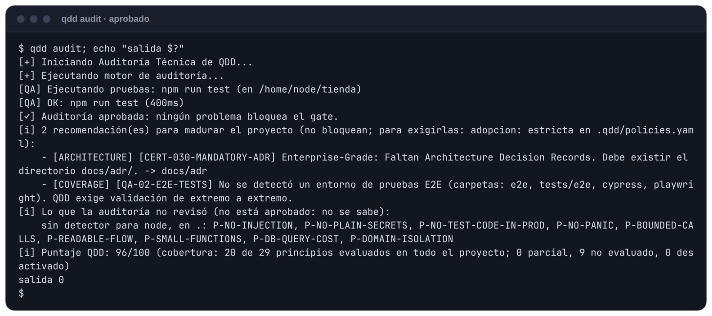
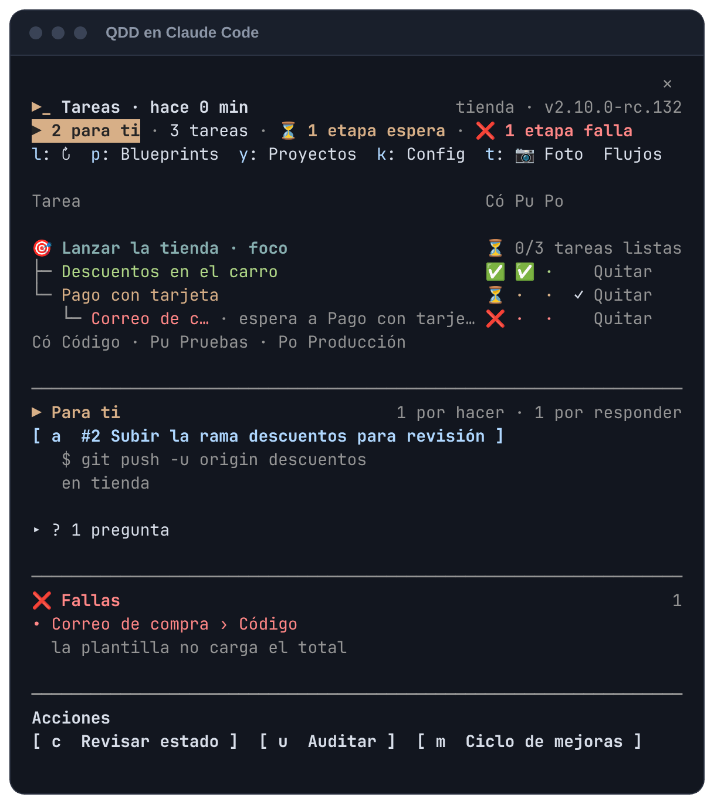
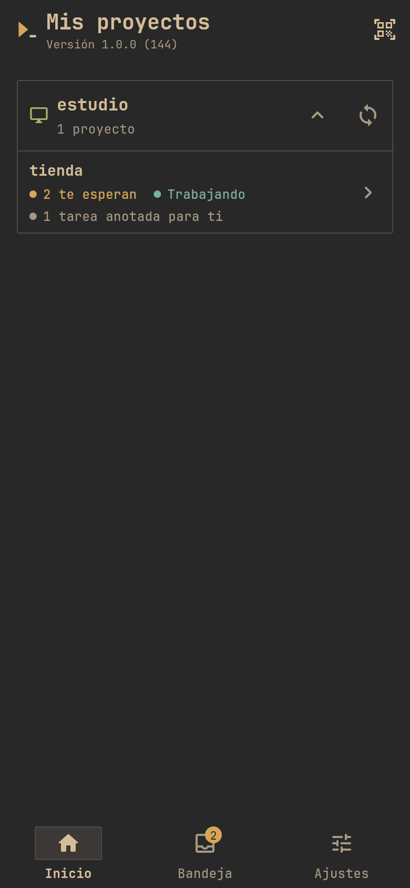
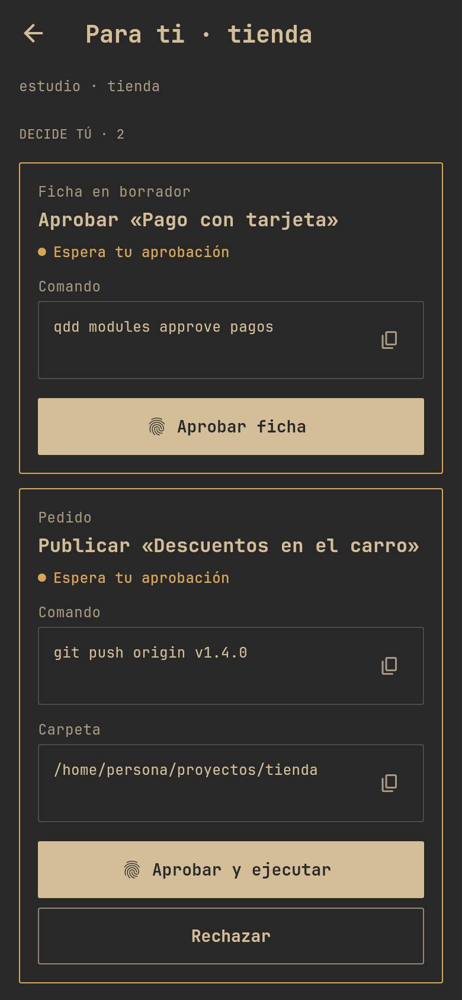

# Getting Started con QDD

De la instalación a tu primer commit con las puertas puestas. En cada paso se dice si es un **comando de terminal** o una
***tool* MCP** (algo que le pides a tu IA). La lista completa está en la [Command Reference](command-reference.md).

## Paso 0: instalar

```bash
npm install -g qdd-framework --allow-scripts=qdd-framework
qdd version
```

npm 12 no corre los scripts de instalación sin esa bandera. Si instalas sin ella, qdd baja su binario desde el release de
GitHub la primera vez que lo usas. Otras formas (sin Node, canal preview, desde el código):
[README](../README.md#instalar).

## Paso 1: iniciar el proyecto

```bash
cd mi-proyecto
git init        # antes de qdd init: las puertas se instalan como hooks de git
qdd init
```

`qdd init` detecta el stack (Node, Go, Java/Kotlin, Python, Dart/Flutter, Rust, PHP, Ruby y .NET, también en subcarpetas) y deja:

| Dónde | Qué |
|---|---|
| `.qdd/config.yaml`, `policies.yaml`, `state.json` | Stack, políticas del gate y versión. Un proyecto nuevo parte en **adopción gradual** y con las puertas activas |
| `.qdd/core/` | El método: manifiesto, principios, certificaciones, plantillas y plugins |
| `.qdd/project/` | El conocimiento de tu proyecto: findings, fichas, sprints, decisiones y evidencia |
| `AGENTS.md`, `.clauderc`, `.cursorrules`, `.antigravityrules`, `.agentrules` y sus carpetas | Las reglas para tu IA |
| `.cursor/mcp.json` | El servidor MCP, para Cursor |
| `tmp/` | Lo temporal; git la ignora |
| `.git/hooks/pre-commit` y `commit-msg` | Las puertas de commit, sin reemplazar los hooks que ya tengas |

Es seguro repetirlo: completa lo vacío y no pisa lo que ya configuraste, salvo lo que declares con banderas.

En una carpeta que todavía no tiene código, declara el stack:

```bash
qdd init --lenguaje Go --arquitectura "API REST"
```

Ahí `qdd audit` bloquea con `QA-00-NO-TEST-COMMAND` hasta que haya pruebas que correr, así que crea el proyecto y su
primera prueba antes del primer commit.

## Conectar el servidor MCP

Las reglas le dicen a la IA qué hacer; el servidor MCP le da las herramientas. `qdd init` lo registra solo para Cursor.

**Claude Code**, en la carpeta del proyecto (crea `.mcp.json`, que puedes versionar):

```bash
claude mcp add --scope project qdd -- qdd mcp-server
```

Con `--scope user` queda para todos tus proyectos. Suma el panel con `qdd consola activar`.

**OpenCode**, en `opencode.json`:

```json
{
  "$schema": "https://opencode.ai/config.json",
  "mcp": {
    "qdd": { "type": "local", "command": ["qdd", "mcp-server"], "enabled": true }
  }
}
```

**Otra IA con MCP:** un servidor por stdio cuyo comando es `qdd mcp-server`. ¿Tu IA no tiene MCP? `qdd modules context <rutas>`
imprime el mismo contexto para pegárselo.

> `.cursor/mcp.json` guarda la ruta absoluta de qdd en tu equipo: si lo versionas, en otro equipo hay que volver a correr `qdd init`.

## Paso 2: la primera auditoría

```bash
qdd audit
```

Corre las pruebas y revisa las reglas, desde cualquier subcarpeta. Separa tres cosas:

- **Lo que bloquea** (sale con 1): pruebas que fallan, código sin formato, findings sin estado, una ficha o un blueprint
  inválidos, un pipeline que despliega sin pasar las pruebas. En Go, además, `else`, inyección SQL, secretos y pánicos.
- **Recomendaciones**: en adopción gradual, E2E, ADR y Conventional Commits se muestran sin bloquear.
- **Lo que no se pudo revisar**: no está aprobado, simplemente no se sabe. El reporte lo nombra.



Si una regla ya bloquea, las pruebas esperan (`QA-04-PRUEBAS-PENDIENTES`); `qdd audit --completo` las corre igual.

Si QDD no reconoce tus pruebas (reconoce npm, Go, Flutter y pytest), decláralas en `.qdd/config.yaml`:

```yaml
test_commands: ["make test"]
```

Para exigir las prácticas de madurez desde el día uno: `adopcion: estricta` en `.qdd/policies.yaml`.

```bash
qdd evolution   # la siguiente mejora que más conviene
qdd doctor      # el entorno completo; con --fix, lo que se puede reparar
```

`evolution` y `doctor` dejan su reporte en `.qdd/project/evidence/`.

## Paso 3: el primer commit

Las puertas piden un audit al día: auditar, y commitear sin tocar nada después.

```bash
git add -A
qdd audit
git commit -m "feat: primer módulo"
```

- Si algo cambió después del audit, el commit se rechaza y dice qué correr.
- Un `fix: …` tiene que nombrar un finding (`FND-NNN`) que exista en `.qdd/project/findings/` con su prueba en `test_result`.
- Publicar (tag, `npm publish`, merge de un PR) no lo hace la IA: lo deja como pedido y tú dices «Sí».

El tablero, los registros del MCP y las carpetas locales de QDD no dejan viejo el audit. Para ver si las puertas sirven:
`qdd puertas informe`.

## Paso 4: las fichas de módulo

Una **ficha** (`.qdd/project/modules/<id>.yaml`) dice para qué existe un módulo, qué no se puede romper y cómo se prueba.
Es lo que la IA lee antes de tocarlo.

```bash
qdd modules                         # las fichas y el código que todavía no tiene
qdd modules approve notificaciones  # tu aprobación
```

Nace de dos formas: la propone la IA (`qdd_module_save`) o la genera un blueprint. En los dos casos queda en **borrador**
hasta que la apruebas. En [modo goal](../rfcs/0015-modo-goal.md), que solo enciendes tú, las aprueba QDD y queda registrado.

## Paso 5: los estándares de tu organización

Si tu organización tiene un repositorio de [blueprints](blueprints.md):

```bash
qdd blueprint add git@github.com:org/qdd-blueprints.git --ref v1.0.0 notificaciones
qdd blueprint apply notificaciones --ruta internal/notificaciones
qdd modules approve notificaciones
```

`apply` te hace las preguntas de diseño; la IA nunca las responde por ti. Desde ahí el gate exige una prueba por cada
escenario del estándar (`BP-08-CONFORMIDAD`). Si todavía no tienen uno, sáltate este paso.

## Paso 6: trabajar con tu IA

```text
/qdd agrega el envío de notificaciones por correo
/qdd corrige el bug de conexión y registra su finding
```

Las reglas le fijan este método:

1. Llama a `qdd_project_context` con las rutas que va a tocar y respeta la ficha.
2. Pruebas primero; cada bug queda como finding con su prueba de regresión.
3. Si el módulo lo define un blueprint, lo aplica y **te hace a ti** sus preguntas.
4. Declara en qué tarea trabaja y la mueve con evidencia.
5. No commitea ni despliega sin `qdd audit`.

## Paso 7: el tablero y el panel

```bash
qdd estado init --etapas "Código,Pruebas,Publicación"
qdd estado nueva "Envío por correo"     # imprime el id de la tarea
qdd estado set envio-correo Código ok --evidencia "commit abc1234"
qdd consola activar                     # el panel en Claude Code (y en OpenCode, Antigravity o VS Code si están)
```



En el panel, «▶ Para ti» junta lo que espera tu «Sí»: comandos que publican, fichas, preguntas y permisos. Para verlo en
el teléfono: `qdd login` muestra un QR para la app QDD Móvil.

<p>
  
  
</p>

*Las dibuja la app QDD Móvil con un proyecto inventado y el relay simulado.* Antes de usarla, lee [qué queda guardado en el
relay](qdd-movil-comunicacion.md#qué-queda-guardado-en-el-relay).

## Paso 8: certificar y versionar

```bash
qdd certify                                     # audita, calcula el puntaje y lo guarda en el historial
qdd report --format md --output reporte.md
```

`certify` informa y siempre sale con 0; lo que frena es `qdd audit`.

Para etiquetar una versión, la IA puede usar la *tool* `qdd_release`: corre el gate y `npm run build` o `make build` si
existen. Si algo falla lo dice y no crea el tag. Si todo pasa, crea un tag local y anota la versión en `state.json`, que hay
que commitear. Publicarlo es tu decisión.
